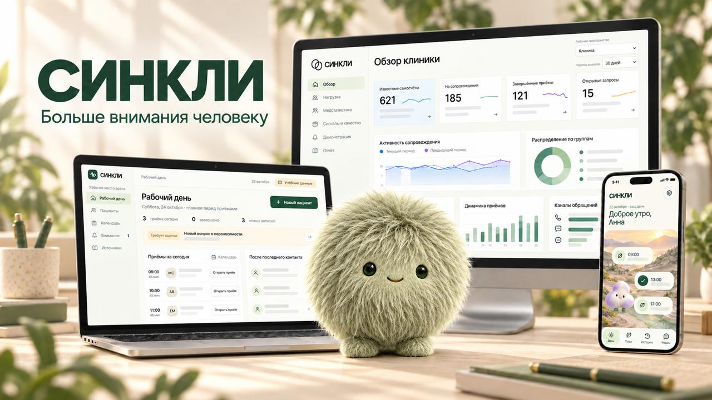

# Синкли



**Синкли** – цифровая экосистема для взаимодействия врача и пациента, созданная для кейс-чемпионата «Клинический компас 2026».

Система объединяет рабочее место врача, мобильное приложение пациента и административную панель. Врач ведёт пациента и формирует план наблюдения, пациент получает назначения и делится самочувствием, а руководитель клиники видит показатели в административном демо.

## Что реализовано

**Кабинет врача** включает карты пациентов, эпизоды и приёмы, клинический контекст, назначения и направления, динамику, дневник, события, сообщения и документы. Доступны формы GAD-7 и PHQ-9, поиск МКБ-10 и каталог регистрационных записей ГРЛС.

**Мобильное приложение пациента** показывает подтверждённые назначения, позволяет отметить их выполнение, заполнить самоотчёт и назначенные опросы, написать врачу и получить ответ. Также в приложении есть персональный мир с пушистым спутником, календарная карта и история.

**Административная панель** показывает демонстрационную аналитику клиники: динамику показателей, нагрузку команды, медицинскую статистику, качество данных и экспорт отчётов. Представлены пространства руководителя, координатора и системного администратора. Панель работает на синтетических данных; её роли и действия являются демонстрационными.

## Покрытие требований кейса

Мы стремились максимально полно представить ключевые сценарии [официального кейса](docs/official/2026-10-15-case.md) в работающей системе:

1. **Оценка состояния** – формы GAD-7 и PHQ-9, сохранение ответов и просмотр результатов.
2. **Информация о терапии** – материалы для врача, ссылки на источники и подготовительная проверка Авиандра.
3. **Риски и нежелательные явления** – клинический контекст пациента, фиксация сведений и очередь событий.
4. **Мониторинг динамики** – история оценок, лечения, самоотчётов и событий в карте пациента.
5. **Самоотчёт пациента** – мобильный интерфейс для заполнения отчёта и просмотра собственной истории.
6. **Коммуникация** – переписка между пациентом и врачом.
7. **Приверженность** – передача подтверждённых назначений и отметки о приёме или пропуске.
8. **Маршрутизация** – направления и различимые категории «обязательно» и «желательно»; автоматические маршруты требуют клинического утверждения.

Сквозной обмен на синтетических данных проверен для назначений, отметок приёма, самоотчётов, сообщений и опросов. Подробности – в [отчёте об интеграции](docs/verification/2026-10-27-patient-doctor-integration.md) и [проверке APK и кабинета](docs/verification/2026-10-27-doctor-integration-polish.md).

## Критерии оценки

- **Научная обоснованность.** Подготовлены источники клинических рекомендаций, паспорта шкал и сведения об инструкциях к препаратам. Клиническое утверждение правил необходимо зафиксировать.
- **Клиническая применимость.** Реализован путь от карты и приёма до плана и последующего наблюдения.
- **Удобство интерфейса.** Подготовлены веб-кабинет врача и мобильное приложение пациента; типовые действия измерены автоматическим прохождением.
- **Обязательные условия.** Реализованы отдельные роли, связь врача с пациентом, подтверждение клинических действий и серверные ограничения доступа. Клинические и организационные условия реального внедрения требуют отдельной проверки.
- **Функции инструмента.** Все восемь направлений кейса представлены в продукте; степень реализации и проверки указана выше.
- **Апробация.** Разработку согласовывали с клиницистами и экспертами по МИС; команда провела опросы пациентов. Систему проверили на синтетических данных. Апробация в медицинской практике требует соблюдения правовых условий и клинического утверждения.

## Технические результаты

Проведены [инженерные измерения локального стенда и VPS](docs/verification/technical-metrics/README.md). Кратко по техническим критериям кейса:

1. **Быстродействие** – измерены отклик API и типовых действий интерфейса; доставка критического алерта отдельно не измерялась.
2. **Обработка входных данных** – на 100 синтетических документах пяти шаблонов полнота извлечения составила 40%; поддержка разных форматов требует доработки.
3. **Надёжность** – проверены серверные команды, повторные отправки, конфликты и ограничения доступа; результаты и обнаруженные ошибки сохранены в отчёте.
4. **Эргономика** – измерены время и число действий при автоматическом прохождении типовых сценариев.
5. **Обоснованность выводов** – проверена прослеживаемость подготовленных выводов к идентификаторам и версиям источников.
6. **Нагрузка** – проведены короткие испытания VPS с конкурирующими запросами; максимальное число независимых пользователей не установлено.
7. **Восстановление** – проверены резервная копия БД и восстановление отдельного экземпляра после процессного сбоя.
8. **Кроссплатформенность** – доступны веб-приложения и Android-сборка.
9. **Масштабируемость** – сервер работает с PostgreSQL; предел для большой клиники не установлен.
10. **Гибкость архитектуры** – проверено расширение существующих каталогов и версий форм.
11. **Работа с данными** – реализованы хранение, поиск и выборки; проведены измерения на синтетических данных.
12. **Полнота модели** – представлены пациент, эпизоды, приёмы, оценки, назначения, отчёты, события, согласия, сообщения, документы и аудит.
13. **Защищённость** – проверены отдельные ограничения доступа, CSRF и настройки HTTPS; полноценный аудит защищённости остаётся отдельным этапом.

**Демонстрационная версия работает на синтетических данных.** Применение с реальными пациентами требует отдельного клинического утверждения, проверки безопасности и условий внедрения.

## Структура проекта

В репозитории находятся:

- `apps/web-doctor` – веб-кабинет врача.
- `apps/mobile-patient` – мобильное приложение пациента на React Native и Expo.
- `apps/web-admin` – демонстрационная административная панель.
- `apps/doctor-api` – сервер на ASP.NET Core с PostgreSQL.
- `packages/ui-web` – общие веб-компоненты; `site` – сайт проекта; `docs` – документация и результаты проверок.

## Попробовать онлайн

Демонстрационная версия проекта готова для тестирования: [открыть сайт «Синкли»](https://syncli-main.layero.app/). На сайте доступны переходы в кабинет врача и административную панель.

**Кабинет врача:** откройте [вход для врача](https://syncli-main.layero.app/doctor/) и используйте тестовую учётную запись:

- Логин: `doctor@example.test`
- Пароль: `7e8aaf59779d09296ff302651509e82155334a16`

**Мобильное приложение пациента:** [скачайте Android-сборку](https://disk.yandex.ru/d/Mf_riMd8eDZdpg), установите её и введите код подключения:

```text
E4E6B4544CCA6F7F
```

**Сценарий проверки:**

1. Войдите в кабинет врача и откройте карту тестового пациента.
2. Подключите мобильное приложение по коду, заполните и отправьте самоотчёт врачу.
3. Откройте карту пациента в кабинете врача и найдите самоотчёт в дневнике. Попробуйте отправить сообщение и ответить на него из кабинета.
4. Откройте административную панель и изучите демонстрационные показатели и фильтры.

## Локальный запуск

Понадобятся Git и Node.js 24 с npm. После клонирования репозитория выполните в его корне:

```sh
npm ci --ignore-scripts
npm run dev
```

Откройте адрес, который выведет Vite. Для отдельных приложений доступны команды `npm run dev:doctor`, `npm run dev:admin` и `npm run dev:mobile`. Веб-кабинет врача также поддерживает локальный учебный режим.

Для локального серверного режима дополнительно нужны .NET SDK 10 и PostgreSQL 17+: настройка и запуск описаны в [инструкции по серверу](docs/doctor-workspace-runbook.md). Требования и сборка Android-приложения приведены в [инструкции мобильного приложения](apps/mobile-patient/README.md). Команда `npm run build` собирает сайт и веб-приложения в корневой каталог `dist/`; для серверного режима врача необходимо настроить маршрутизацию `/api` к серверу.

Для проверки репозитория выполните `npm run check`; дополнительные проверки веба, данных и мобильного приложения – `npm run check:web`, `npm run check:fixtures` и `npm run check:mobile`.

[Документация проекта](docs/README.md) · [Официальный кейс](docs/official/2026-10-15-case.md) · [Правила совместной работы](CONTRIBUTING.md)
