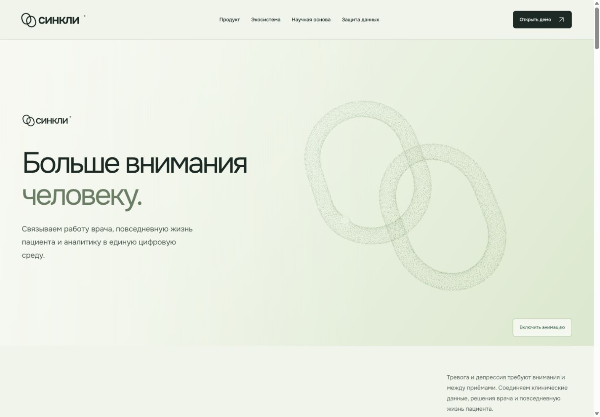
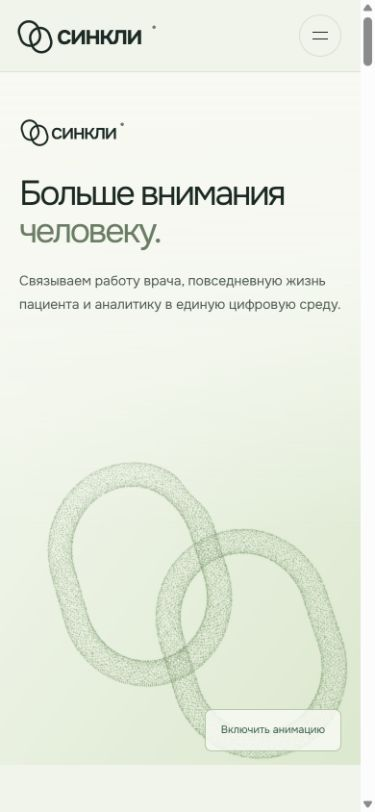
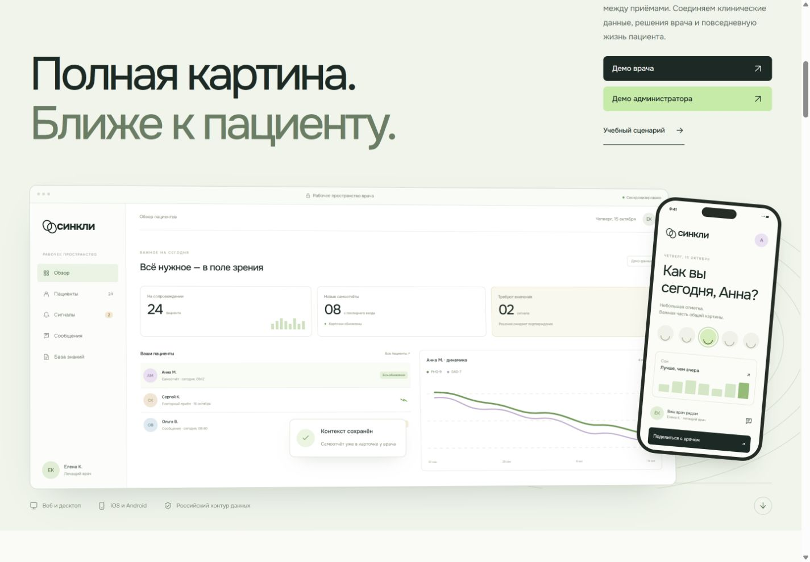

# Перенос анимированного HERO

> **Статус документа:** Историческое свидетельство: результаты и ограничения относятся к указанной ниже дате и версии. Они не являются текущим статусом всего продукта. [Текущее состояние](../status.md).

Пользователь утвердил зелёный прототип и поручил добавить его первым экраном, сохранив прежний блок с мокапами ниже. Затем поручил открыть PR в main. Задача [#20](https://github.com/souponin-d/psycho/issues/20), владелец souponin-d, ветка `codex/20-landing-hero`, база `origin/main` 7e971aa. Прямой push в main не выполнялся.

## Результат

- Заголовок: «Больше внимания человеку.»
- Подзаголовок: «Связываем работу врача, повседневную жизнь пациента и аналитику в единую цифровую среду.»
- Сохранены геометрия двух колец, зелёный градиент, ускорение 1,2, вращение собранного знака, рассеивание и локальный отклик на курсор.
- Прежние текст, компьютер, телефон, плавающая карточка, платформы и ссылки в демо сохранены следующим разделом. Его заголовок стал h2; единственный h1 принадлежит новому HERO.
- Кнопка паузы доступна с клавиатуры. Системная настройка уменьшенного движения оставляет знак статичным до явного включения. Без WebGL или после потери контекста доступен резервный знак.
- В скрытой вкладке и вне экрана кадры не запрашиваются. Уход со страницы освобождает обработчики и GPU-ресурсы; возврат из кеша браузера возобновляет сцену.
- Новых зависимостей и внешних ресурсов нет; используется существующий локальный Onest.

## Проверки

Windows, Node.js 24, npm 11.17; 20 октября 2026 года:

Перед подготовкой PR проверки повторены после обновления рабочей ветки до `origin/main` 7e971aa: `check`, `check:web` и `check:fixtures` завершились с кодом 0; количество тестов осталось 38 и 34 соответственно. Синтаксис модуля и `git diff --check` также прошли.

| Команда                                                                       | Фактический результат                                                     |
| ----------------------------------------------------------------------------- | ------------------------------------------------------------------------- |
| `npx vitest run --project tools scripts/hero-animation.test.ts` до реализации | Ошибка импорта отсутствующего модуля — ожидаемая красная проверка         |
| Та же команда после реализации                                                | 1 файл, 7 тестов прошли                                                   |
| `node --check site/hero-animation.js`                                         | Код завершения 0                                                          |
| `npm run check`                                                               | Форматирование, ссылки Markdown, синтаксис лендинга и общая сборка прошли |
| `npm run check:web`                                                           | TypeScript; 8 файлов, 38 тестов; обе отдельные сборки прошли              |
| `npm run check:fixtures`                                                      | 2 файла, 34 теста; normal, empty и long соответствуют схеме               |

Тесты жизненного цикла покрывают отсутствие WebGL, ошибку компиляции шейдера, уменьшенное движение и ручной запуск, остановку вне экрана, сохранение ручной паузы, скрытую вкладку, потерю/восстановление контекста и очистку. GPU-граница заменена в jsdom; реальные шейдеры проверены визуально в браузере.

Собранный сайт проверен через Vite preview на локальном порту 8790. На ширинах 1440, 768, 390 и 320 px горизонтального переполнения нет; заголовок и подзаголовок помещаются. Пауза переключается нажатием Enter. «Открыть демо» ведёт к сохранённому разделу. Консоль браузера не содержит ошибок на проверенных широком и узком экранах. Это проверка рекламного интерфейса, не клинического процесса.

## Скриншоты производственной сборки

Отдельная AI-проверка кода не выявила существенных замечаний и повторно подтвердила 7/7 тестов и синтаксис модуля. Необязательное улучшение: отдельный тест возврата из кеша браузера (persisted pagehide → pageshow); соответствующая ветка реализована, но сейчас не покрыта тестом. Это не независимое одобрение участником команды для PR.

Сцена приостановлена для фиксации собранного знака:

## Откат

Миграций и изменений данных нет. Для отмены только переноса HERO удалить новый раздел и его стили, убрать подключение `hero-animation.js`, вернуть прежнему заголовку h1 и соответствующие селекторы. Ранее согласованные правки раздела «Команда» и навигации сохраняются отдельно.
