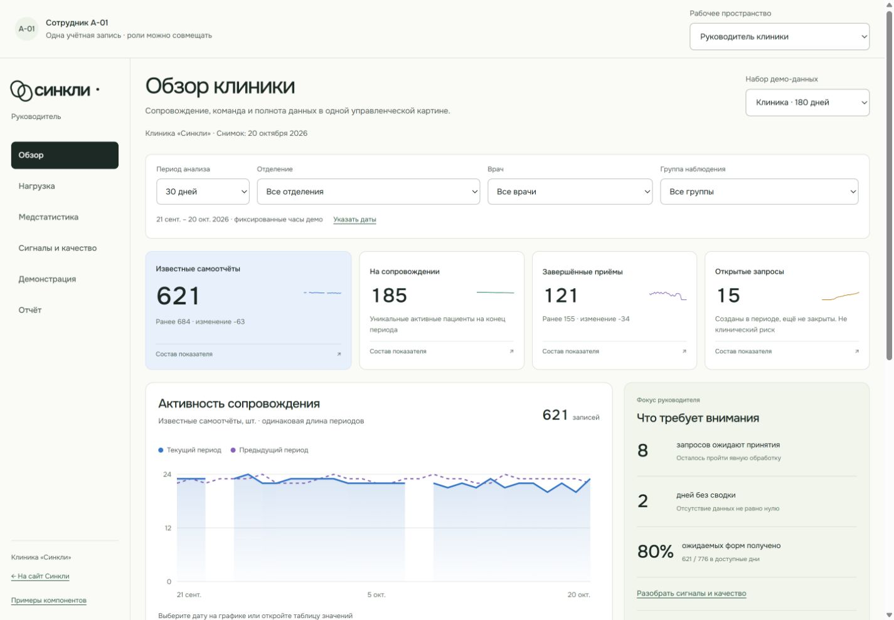
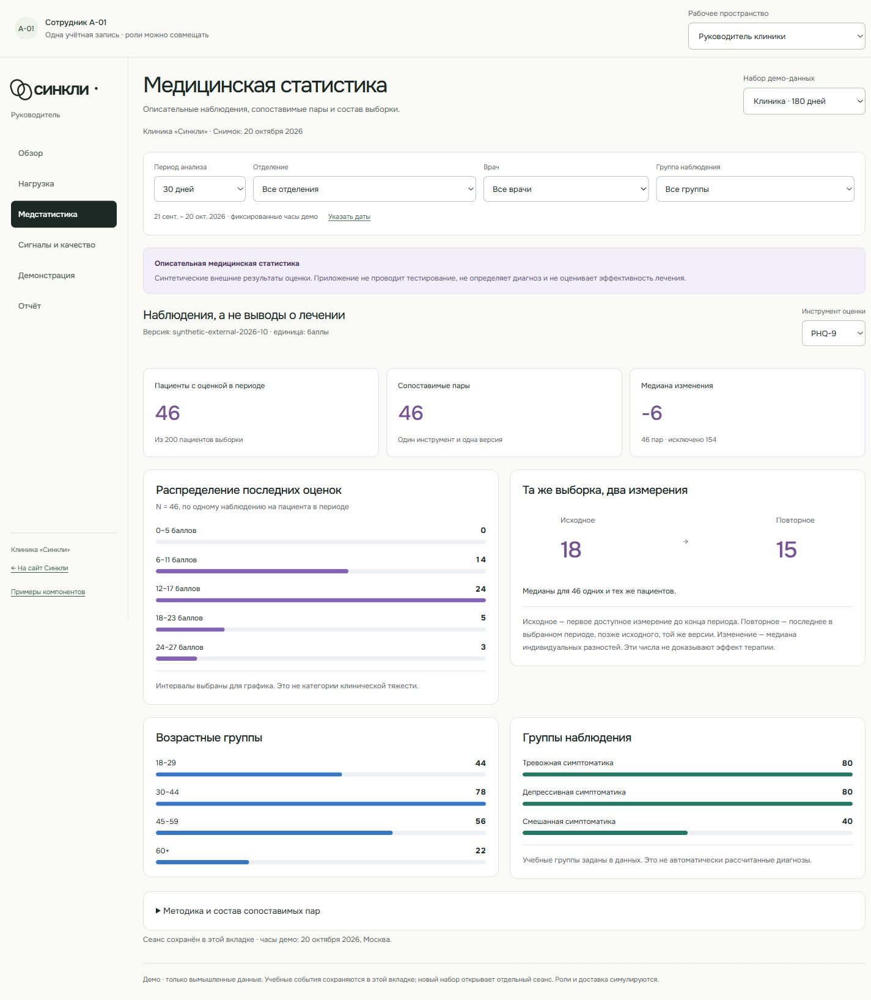

# Аналитическое демо администратора · 22 октября 2026

Основание: прямое поручение пользователя реализовать результаты аудита для руководителя клиники и жюри. [Дизайн и границы](../superpowers/specs/2026-10-22-admin-analytics-design.md), [план](../superpowers/plans/2026-10-22-admin-analytics.md). Это локальная демонстрация главы разработки; файлы presentation задач #5–#8, общий контракт, API, mobile и зависимости не изменены.

## Запуск

Из корня с Node.js 24/npm: `npm ci --ignore-scripts`, затем `npm run dev -- --port 8765`. Открыть [административное демо](http://127.0.0.1:8765/demo/admin/). Отдельный запуск: `npm run dev:admin`, адрес [127.0.0.1:8768](http://127.0.0.1:8768/). Backend и БД не нужны.

Основной вход открывает руководителя. Переключатель «Рабочее пространство» сохраняет координатора и системного администратора. Одна учётная запись совмещает три роли. Наборы «Клиника · 180 дней», «Новое отделение», «Длинные подписи» имеют отдельные события и фильтры в `sessionStorage`. Перезагрузка восстанавливает сеанс в этой вкладке. Новая вкладка не является каналом синхронизации. Явный сброс с подтверждением находится в разделе «Демонстрация».

## Маршрут показа · 5–7 минут

1. В обзоре показать 185 активных пациентов из 200 учебных записей, 621 известный самоотчёт, 121 завершённый приём и 15 открытых запросов за 21 сентября — 20 октября. Объяснить два разрыва сводки и сравнение с непересекающимся предыдущим периодом. Открыть состав одного KPI.
2. Выбрать отделение и врача; проверить изменение графика, таблицы и состава. Показать нагрузку 12 врачей и тепловую карту приёмов. Это количество событий, а не рейтинг качества или процент занятости.
3. В медстатистике переключить PHQ-9/GAD-7, показать распределение, число пар, исключения, состав групп и методику. В исходной 30-дневной выборке PHQ-9: 46 пар, 154 исключения, медиана индивидуального изменения −6 баллов. Медианы двух измерений 18 и 15; их разность не обязана совпадать с медианой индивидуальных разностей.
4. В «Демонстрации» отправить подготовленный самоотчёт П-001, принять событие учебным врачом, подтвердить просмотр и ответ. Общая история растёт с 3675 до 3676 записей; KPI 30 дней — с 621 до 622. Открытых запросов сначала 16, после ответа снова 15. Повторная отправка отключена. Перезагрузить страницу и показать восстановление журнала.
5. Переключить координатора: подтвердить встречу Д-03 на 22 октября, 16:30. Она появляется в расписании команды. Встречи остальных кабинетов подготовлены заранее; отсутствие даты у Д-01 обозначено явно. Самоотчёт П-001 закрывает ожидание координатора.
6. Переключить системного администратора: добавить руководителя сотруднику А-02, сохранить и показать состав «до → после» и время в журнале. Собственная запись и врачи остаются только для просмотра. Повторное сохранение без изменений недоступно.
7. В отчёте выбрать Консультативное отделение: 69 активных пациентов, 229 самоотчётов, 49 завершённых приёмов, четыре врача. Скачать CSV и сопоставить с экраном. Показать подготовленный печатный отчёт и ограничения. Перед следующим показом сбросить сеанс.

## Данные и методика

Генератор фиксирован на 20 октября 2026, Москва: 200 пациентов, 12 врачей, 3 отделения, 180 календарных дней истории. Неравномерны размеры кабинетов, возрастные и учебные группы, число событий и направления изменения внешних оценок. Есть закрытые эпизоды, отмены, неявки, будущие встречи, все три стадии запросов, пропуски сводки и пациенты без повторной оценки. Будущие встречи не входят в исторические завершённые приёмы.

Все срезы строятся из тех же событий. Вложенная кабинетная сумма больше полной теперь отклоняется схемой: исправлена ошибка A01. Дневные суммы, командные разрезы, детализация и экспорт сверяются тестами. Предыдущий период выбирает свой состав пациентов, включая эпизоды, завершившиеся до текущего периода. Несуществующие даты не нормализуются JavaScript молча.

Выполнение форм = уникальные полученные формы / ожидаемые формы в доступные дни; при нулевом знаменателе показано «Нет данных». Дни без сводки исключаются из знаменателя и рисуются разрывами. Активные пациенты определяются на конец периода; состав пациентов для событий включает эпизоды, пересекающие период. Открытые запросы — созданные в выбранном периоде и ещё не закрытые. Это не весь исторический остаток обращений.

PHQ-9/GAD-7 представлены заранее подготовленными внешними синтетическими наблюдениями версии `synthetic-external-2026-10`. Приложение не проводит анкетирование и не использует клинические пороги. Для пары нужны два разных измерения одной шкалы и версии; исходное — первое до конца периода, повторное — последнее в выбранном периоде, позже исходного. Показаны N, исключения и медианы. Интервалы гистограммы равной ширины не являются категориями тяжести. Данные не доказывают эффективность лечения.

## Проверка

| Проверка                     | Фактический результат                                                                                                                 |
| ---------------------------- | ------------------------------------------------------------------------------------------------------------------------------------- |
| `npm run check`              | PASS: формат, Markdown-ссылки, синтаксис сайта, объединённая production-сборка                                                        |
| `npm run check:web`          | PASS: TypeScript, 57 тестов в 12 файлах, отдельные сборки врача и администратора                                                      |
| `npm run check:fixtures`     | PASS: 61 тест в 4 файлах, проверка схем normal/empty/long                                                                             |
| `git diff --check`           | PASS                                                                                                                                  |
| Сквозной сценарий в браузере | 621 → 622, принятие и ответ, восстановление после reload без дублей                                                                   |
| Фильтр и CSV                 | Консультативное отделение: 69 / 229 / 49, четыре врача, BOM и кавычки в CSV                                                           |
| Клавиатура                   | Enter открывает состав, Escape закрывает и возвращает фокус; диапазон из одного дня доступен через фокус ползунка                     |
| Responsive                   | Три роли проверены при ширинах 1440, 768, 375; на 375 также long/empty; переполнения документа нет                                    |
| Production preview           | Корневой `dist`, вход `/demo/admin/`, обзор и отправка формы; ошибок/warn в консоли не обнаружено                                     |
| AI-ревью                     | Замечания о запросе после закрытия эпизода и однодневном клавиатурном выборе воспроизведены RED-тестами, исправлены и проверены GREEN |

Финальный `npx vitest run`: PASS, 118 тестов в 16 файлах. Поведенческие проверки также покрывают повреждённый snapshot без перезаписи до сброса, отказ хранилища и повтор сохранения, отдельные фильтры наборов, неверные ссылки/даты, дубли ID/окна формы, недопустимые переходы, неизменность исходного набора и отмену черновика ролей. Проверки не требуют .NET, БД или мобильных SDK.

Вызов `window.print` проверен тестом. Встроенный браузер не предоставил управляемый системный предпросмотр после вызова печати; фактическая пагинация сохранённого PDF и физическая печать не подтверждены. CSV скачан и прочитан. Нет проверки screen reader, реального телефона или серверной доставки. AI-ревью не является независимым contributor approve.

## Скриншоты

[Нагрузка и тепловая карта](assets/admin-analytics/load-1440.png), [сигналы и качество](assets/admin-analytics/quality-1440.png), [сквозной сценарий](assets/admin-analytics/journey-1440.png), [координатор](assets/admin-analytics/coordinator-1440.png), [системный администратор](assets/admin-analytics/system-1440.png), [отчёт выбранного отделения](assets/admin-analytics/report-1440.png), [мобильный обзор](assets/admin-analytics/overview-375.png), [длинные подписи](assets/admin-analytics/long-375.png), [новое отделение](assets/admin-analytics/empty-375.png).

## Применение и восстановление

Миграций и новых зависимостей нет. Сборка: `npm run build`, публикуется весь корневой `dist/`. Откат — вернуть предыдущую версию статической сборки. Учебные изменения удаляются кнопкой «Начать новый сеанс»; повреждённый snapshot не перезаписывается до явного сброса.

Ветка ограничена локальным демо: нет реальной авторизации, clinic isolation, подключения врачебного API/нативного пациента, экстренных уведомлений, назначений и клинической апробации. F04/F05/F06 показываются как учебная последовательность, а не принятый клинический workflow. Изменения предназначены для PR и независимого просмотра; прямого push/merge в main нет.
