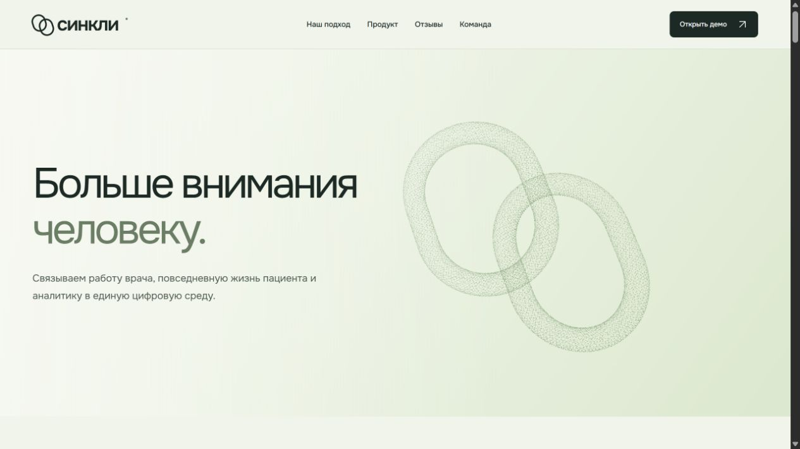
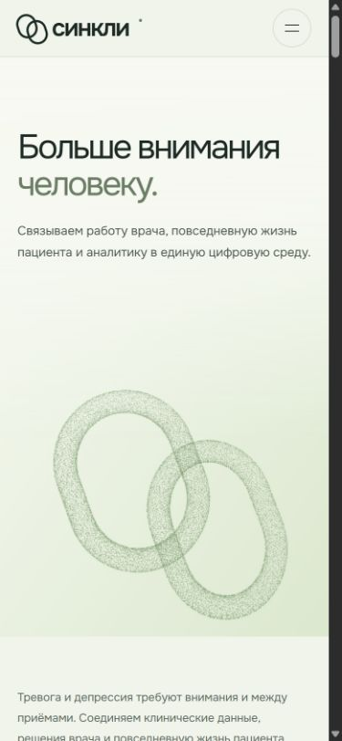
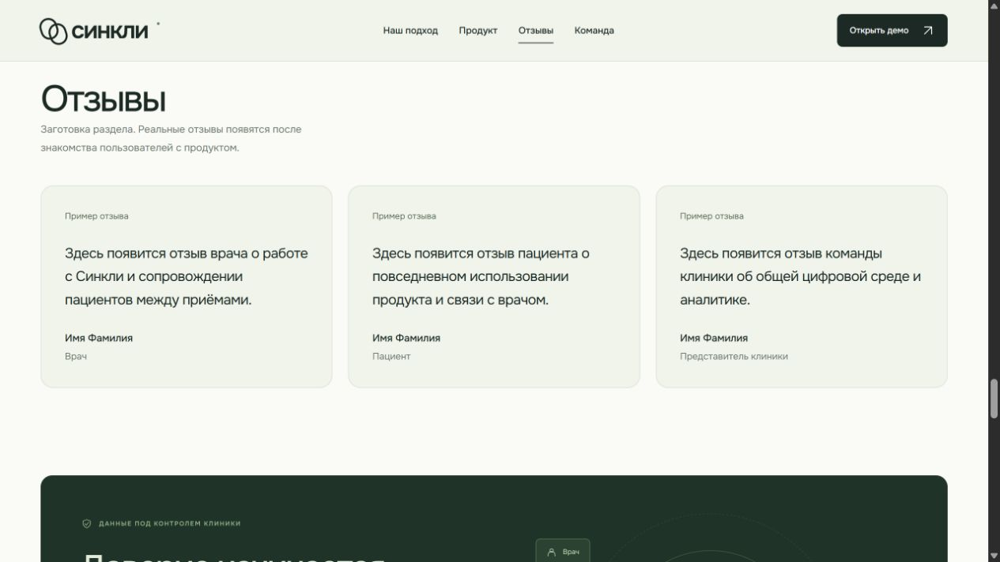
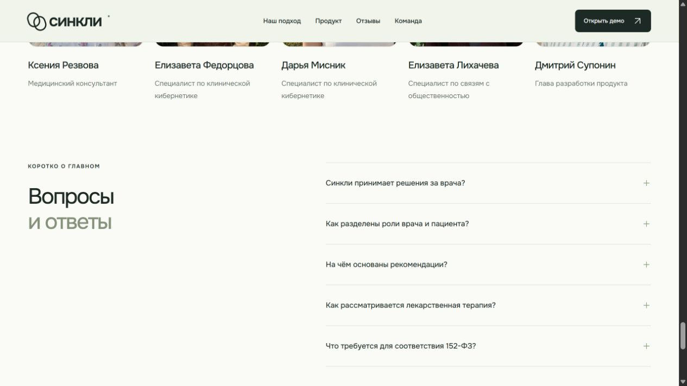

# HERO, шапка и отзывы — 22 октября 2026

Локальная доработка в ветке codex/team-photos по прямому поручению пользователя. Ранее добавленные фотографии и подписи команды сохранены. Публикация и PR этим поручением не запрошены.

## Изменения

- Убран дополнительный логотип внутри HERO, слоган немного увеличен. Заголовок с подзаголовком выровнены по вертикальному центру; левое выравнивание сохранено по композиции скриншота.
- HERO уменьшен по высоте: при 1280 px ширины примерно 589 px вместо 653 px. Шапка — 79 px с границей вместо 95 px, закреплена сверху; её контейнер ограничен 1240 px.
- Кольца утолщены с 0,077 до 0,09; сила реакции курсора 0,65 вместо 1, сглаживание 4,5 вместо 7. Сохранены скорость и цикл сборки, вращения, рассеивания.
- Удалены кнопка паузы и её обработчики. Системное уменьшенное движение сохраняет статичную сцену. Кадры останавливаются вне экрана и в скрытой вкладке; fallback и освобождение GPU сохранены.
- Навигация: «Наш подход», «Продукт», «Отзывы», «Команда». Мобильное меню закрывается после выбора. Якорь возврата наверх перенесён на body, чтобы sticky-шапка не мешала прокрутке.
- Добавлены три явно обозначенные заглушки отзывов, без приписывания вымышленного опыта реальным людям.
- Удалён прежний заголовок «Полная картина. Ближе к пациенту.»; компьютер, телефон, описание и демо сохранены.
- FAQ: «Вопросы» и «и ответы» на второй строке, с прежним двухцветным оформлением.

## Проверки

- npm run check — код 0: форматирование, ссылки, синтаксис лендинга и production-сборка.
- npm run check:web — код 0: TypeScript, 41 тест в 8 файлах, обе самостоятельные сборки.
- Проверки анимации — 10/10. Сначала воспроизведена зависимость от удалённой кнопки; отдельно воспроизведено преждевременное переключение колец на мобильную композицию при viewport 768 px и контейнере 753 px из-за полосы прокрутки. Оба случая исправлены. Для композиции используется тот же matchMedia, что и в CSS.
- node --check site/hero-animation.js и git diff --check — код 0.
- Браузер production preview: 1280, 768, 390 и 320 px; горизонтального переполнения нет. Вертикальный центр текстовой группы на широком экране совпадает с центром HERO. Проверены закрепление шапки, ссылки к отзывам и команде, мобильное меню и возврат наверх (scrollY = 0).
- Ошибок консоли на проверенных экранах нет. Safari, Firefox и реальные мобильные устройства не проверялись. Фотографии команды загружаются, порядок сохранён.

## Виды

Новых зависимостей, контрактов, прав, миграций и клинической логики нет. Откат — вернуть изменённые файлы сайта и тест анимации через отдельный revert PR при последующей интеграции.
