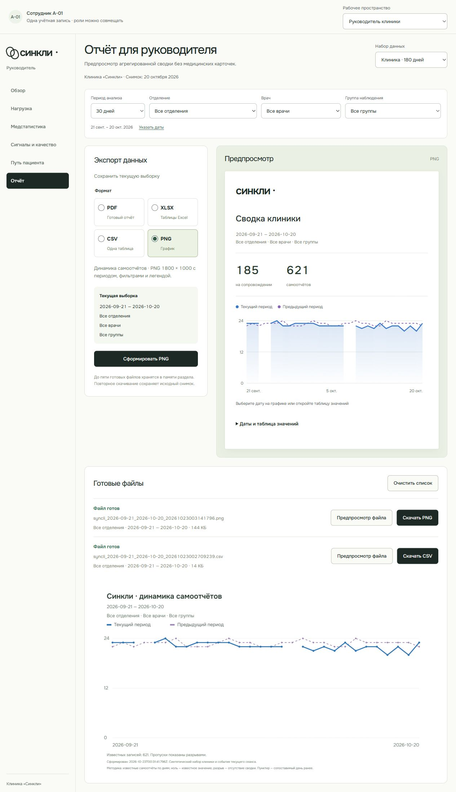

# Центр экспорта административного веба

> **Статус документа:** Историческое свидетельство: результаты и ограничения относятся к указанной ниже дате и версии. Они не являются текущим статусом всего продукта. [Текущее состояние](../status.md).

Задача пользователя: реализовать только центр экспорта; остальные девять визуализаций подготовить заново для утверждения. Раздел руководителя `#/director/report` теперь формирует файлы локально. Три рабочих пространства, клинические расчёты, данные и графики остальных разделов сохранены.

## Что показать

1. Открыть «Отчёт» руководителя, выбрать период, отделение, врача и группу. Предпросмотр показывает тот же состав, который попадёт в файл; на экране первые восемь строк, в файле все строки.
2. PDF — готовый A4-отчёт с локальным кириллическим шрифтом, графиком при выборе динамики, таблицами, повторяющимися заголовками и номерами страниц. Состав выбирается флажками; методика обязательна.
3. XLSX — отдельные листы выбранных разделов и методики, числовые значения, настоящие даты, пустые ячейки для отсутствующих сводок, переносы длинных подписей, закреплённая строка и автофильтр.
4. CSV — одна явно выбранная таблица в UTF-8 с BOM, разделитель `;`, кавычки и защита текстовых значений от превращения в формулы. Метаданные добавлены колонками с префиксом «Метаданные:», чтобы заголовки оставались однозначными.
5. PNG — текущая динамика 1800 × 1000 с периодом, фильтрами, легендой, временем формирования, источником и пояснением пропусков. Единственная известная точка остаётся видимой; дни без сводки разрывают линию.
6. Сформировать файл, сменить фильтр и скачать старый файл повторно. До пяти готовых файлов хранятся в памяти раздела вместе с исходными снимками. Перезагрузка или уход из раздела очищает эту историю. Данные на сервер не отправляются.
7. Показать отмену, повтор после ошибки и пустую выборку: она объясняется, кнопка формирования недоступна. На узком экране настройки и предпросмотр идут последовательно, широкие таблицы прокручиваются внутри фокусируемого блока.

## Фактическая проверка

| Проверка                  | Результат                                                                                                                                                                                     |
| ------------------------- | --------------------------------------------------------------------------------------------------------------------------------------------------------------------------------------------- |
| `npm ci --ignore-scripts` | PASS; после остановки dev-сервера, удерживавшего нативный файл сборщика                                                                                                                       |
| `npm run check`           | PASS: формат, ссылки, синтаксис сайта, общая production-сборка                                                                                                                                |
| `npm run check:web`       | PASS: TypeScript, 69 тестов в 16 файлах, обе самостоятельные сборки                                                                                                                           |
| `npm run check:fixtures`  | PASS: 61 тест в 4 файлах и схемы normal/empty/long                                                                                                                                            |
| `npm audit`               | 0 уязвимостей                                                                                                                                                                                 |
| `git diff --check`        | PASS                                                                                                                                                                                          |
| Проверки экспорта         | 12 новых тестов: снимок, фильтры, пропуски, CSV, XLSX read-back, многостраничный PDF, PNG, отмена, ошибка и повтор                                                                            |
| Браузер                   | PDF/XLSX/CSV сформированы и скачаны; PNG сформирован и отображён как готовое изображение                                                                                                      |
| PDF                       | Файл браузера — 4 страницы A4; отдельно длинные подписи за 180 дней — 10 страниц. Poppler отрендерил первую, страницу переноса таблицы и последнюю; однодневный график содержит видимые точки |
| Адаптивность и клавиатура | Десктоп и 375 px, long/empty; горизонтального переполнения документа нет. ArrowRight прокручивает таблицу с фокуса                                                                            |
| Техническое AI-ревью      | Исправлены три P2: одиночные точки, высота строк XLSX и метаданные PNG. Дополнительно устранены дубли заголовков CSV и перенос слов по буквам в PDF                                           |

Тесты читают настоящий XLSX обратно через ExcelJS и настоящий PDF через pdf-lib. Браузерная проверка PNG подтверждает отображение результата canvas; отдельная ручная проверка PNG в стороннем редакторе не проводилась. Screen reader, физическая печать, настольный Excel и мобильное устройство не проверялись. AI-ревью не заменяет независимое одобрение участника.

Объединённая production-сборка проверена по `/demo/admin/`: PDF успешно сформирован с локальным шрифтом и встроенным предпросмотром, предупреждений и ошибок в консоли этой проверки нет. Однодневный PNG также сформирован и отображён на ширине 375 px.

## Зависимости и поставка

Добавлены точные версии `exceljs 4.4.0`, `pdf-lib 1.17.1`, `@pdf-lib/fontkit 1.1.1`. Корневой override фиксирует используемый ExcelJS `uuid` на `11.1.1`; генерация и повторное чтение XLSX проверены. Библиотеки загружаются при формировании соответствующего формата. Vite предупреждает о ленивых чанках ExcelJS (~929 КБ) и fontkit (~711 КБ); порог предупреждения не менялся. Основной admin JS — ~475 КБ до gzip.

Миграций, серверных endpoint и изменений общей схемы нет. Публикуется весь корневой `dist/`, включая ленивые чанки и шрифт. Откат — предыдущая статическая сборка; совместимость sessionStorage не менялась. Новые направления инфографики, плотной аналитики и редакционного отчёта переданы отдельными эскизами; они не внедрены в приложение до выбора пользователя.

## Скриншоты

[Длинные подписи на 375 px](assets/admin-export/long-375.png), [пустая выборка](assets/admin-export/empty-375.png), [PDF с одним днём](assets/admin-export/pdf-single-day.png).
