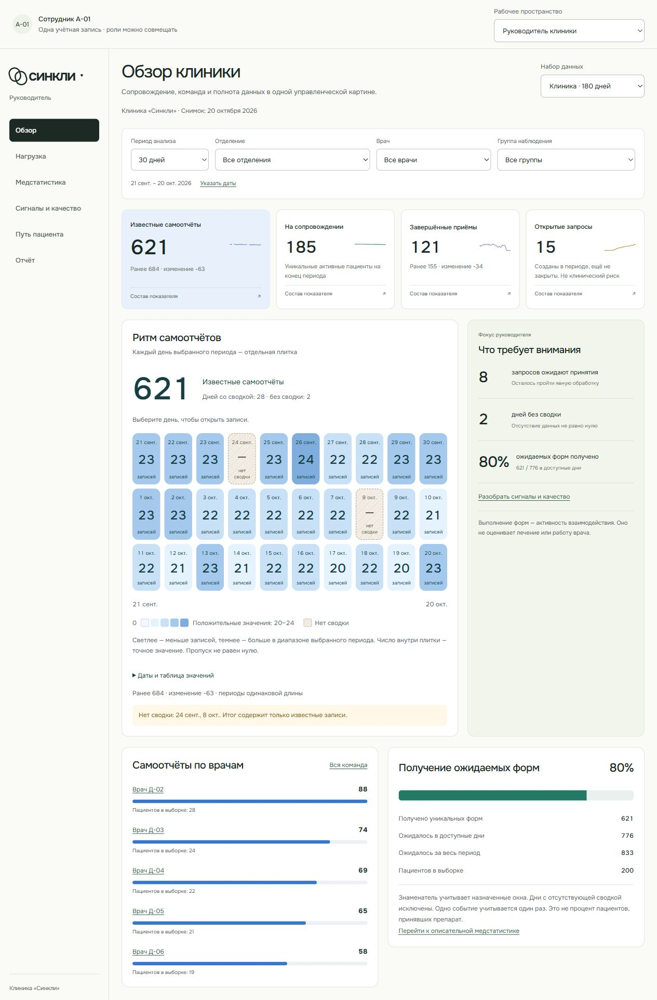

# А3: календарь самоотчётов в обзоре

> **Статус документа:** Историческое свидетельство: результаты и ограничения относятся к указанной ниже дате и версии. Они не являются текущим статусом всего продукта. [Текущее состояние](../status.md).

По уточнённому выбору пользователя реализован только вариант А3 «Ритм самоотчётов». Начатая редакционная подача C отменена до коммита. В обзоре руководителя линейная визуализация заменена календарём с датами и точными числами. Медстатистика, остальные графики, три роли и центр экспорта сохранены.

Цвет кодирует количество в диапазоне положительных значений выбранного периода; шкала указана в легенде. Белая плитка с нулём означает известный ноль. Бежевый штрихованный день с тире и подписью «нет сводки» не открывает несуществующие записи. Цвета не кодируют клинические категории.

Каждый доступный день — обычная кнопка. Нажатие мышью, Enter или Space открывает существующую детализацию самоотчётов. Escape возвращает фокус к дню. Сохранены таблица точных значений, сопоставимые даты прошлого периода и предупреждение с датами отсутствующих сводок. Пустая выборка объясняется без календаря нулей. Фильтры периода, отделения, врача и группы используют тот же результат агрегирования.

## Проверка

- Компонентные проверки воспроизвели отсутствие нового компонента до реализации; затем прошли сценарии известного нуля, пропуска, клавиатурного открытия и пустого состава.
- В браузере Enter открыл 23 записи за 21 сентября; Escape вернул фокус. Консультативное отделение показывает 229 самоотчётов.
- Проверены desktop и 375 px. На 375 px ширина документа 360 px без горизонтального переполнения. Для long за 180 дней показаны все 180 плиток; пустой набор показывает объяснение.
- Веб-проверка после восстановления таблицы: 72 теста в 17 файлах. Данные: 61 тест в 4 файлах, схемы normal/empty/long корректны. `npm run check`, `npm run check:web`, `npm run check:fixtures` и `git diff --check` прошли.

Техническое AI-ревью выявило подпись нулевой легенды в периоде только с пропусками. Добавлен RED-тест, подпись исправлена на «Нет доступных сводок», общее число заменено тире. AI-ревью не является независимым contributor approve.

Новых зависимостей, схем, серверных вызовов и клинических расчётов нет. Сборка и откат стандартные: публикуется весь корневой `dist/`; откат — предыдущая статическая сборка. Screen reader и физическое мобильное устройство не проверялись.

[Версия на 375 px](assets/admin-calendar/mobile-375.png).
