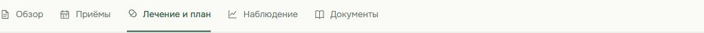
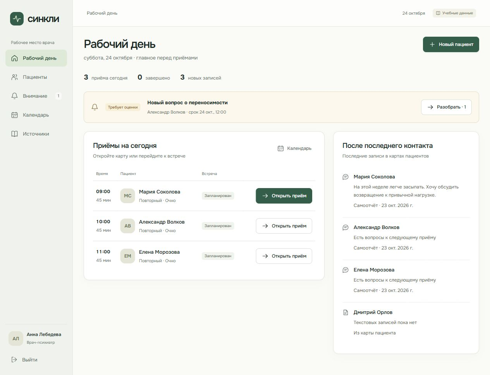
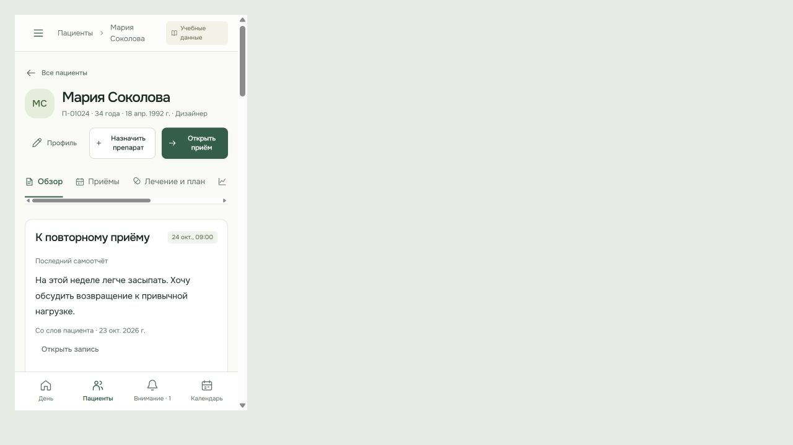
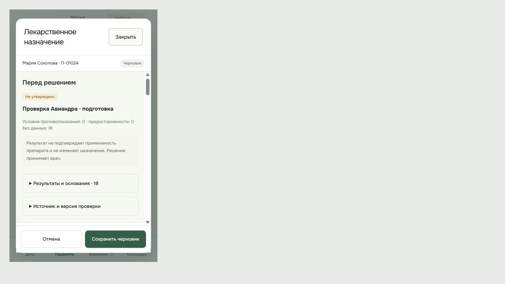

# Сверка с принятыми картинками кабинета врача

24 октября 2026 пользователь заметил отсутствие иконок вкладок и попросил проверить остальные изменения. Причина подтверждена в коде: ссылки содержали только подписи, SVG в них вообще не были добавлены. Предыдущий перенос не был полным по визуальным деталям.

## Сверка и исправления

| Экран / часть    | Результат проверки                                                                                                                                                                                                                                                                                                           |
| ---------------- | ---------------------------------------------------------------------------------------------------------------------------------------------------------------------------------------------------------------------------------------------------------------------------------------------------------------------------- |
| Вкладки карты    | Добавлены все пять иконок. В браузере размер каждой SVG — 15 px; проверены обычный и узкий просмотр. Порядок и подписи соответствуют принятому изображению.                                                                                                                                                                  |
| Навигация        | «Внимание» находится перед календарём, включая нижнюю мобильную навигацию.                                                                                                                                                                                                                                                   |
| Обзор            | Сводка, исходная динамика, контекст и переход в существующий приём сохранены. Восстановлены иконки плана и отметка ближайшего контакта, исправлена подпись возраста.                                                                                                                                                         |
| Лечение и план   | Добавлен пропущенный блок «Контроль и договорённости», реальные указания подтверждённого плана, переход в дневник. Кнопка контакта открывает существующий AppointmentForm, а не макет. Подписи фильтров приведены к эталону.                                                                                                 |
| Приём            | Два основных поля повторного визита, дополнительные сведения и горизонтальные этапы присутствуют. Добавлена пропущенная последняя оценка: значение, шкала, версия и дата без медицинской интерпретации.                                                                                                                      |
| Авиандр          | Добавлены имя/код пациента, статус черновика, знак и название препарата. Сокращено дублирование выбранного препарата, уточнения компактнее и доступны сразу; происхождение и дополнительные сведения раскрываются отдельно. Известные предосторожности показаны перед отсутствующими данными. Медицинский расчёт не изменён. |
| Рабочий день     | Восстановлены компактная таблица со статусом встречи, аватары, стрелки действий, иконки уведомления и записей. Внимание остаётся перед расписанием.                                                                                                                                                                          |
| Очередь внимания | Сроки и клиническая срочность разделены, фильтры сохранены. Добавлены аватары пациентов и стрелки действий.                                                                                                                                                                                                                  |
| Узкий просмотр   | В iframe 375×640: все SVG вкладок имеют ширину 15 px, ширина страницы равна клиентской ширине 360 px с учётом полосы прокрутки. В Авиандре границы результата и формы совпадают без наложения; раскрыты все 18 оснований.                                                                                                    |

## Сохранённые особенности действующего приложения

Прототип не является источником медицинской логики. В приложении оставлены действующие формы профиля, конфликты черновиков, начало и подтверждение приёма, изменение статуса и создание новой версии назначения, источники, согласия и архивирование. Надпись «Открыть приём» ведёт к существующей записи, где начало фиксируется отдельным действием. В карточках показаны реальные данные учебной карты, поэтому содержание и высота отличаются от статического прототипа. Пиксельное тождество всех экранов не заявляется.

## Проверки

- Новый сценарий контакта: RED — блока не было; GREEN — открывается настоящий диалог записи, команда сохранения не выполняется при простом открытии.
- `npm run check:web`: TypeScript, контракт, формы, 26 файлов / 181 тест, обе web-сборки.
- `npm run check`: форматирование, ссылки, синтаксис и общая сборка.
- `npm run check:fixtures`: 4 файла / 61 тест и проверка normal/empty/long.
- Браузерная сверка обзора, плана, приёма, рабочего дня, внимания и Авиандра по сохранённым изображениям принятого прототипа. Дополнительно проверены мобильные вкладки и форма.

Эта сверка выполнена локально; публикация изменений выполняется отдельно по поручению пользователя. API, схема, зависимости, каталог и клинические правила не менялись; статус Авиандра остаётся неутверждённым. Проверка интерфейса не заменяет независимое ревью и клиническую валидацию.

## Снимки проверки

