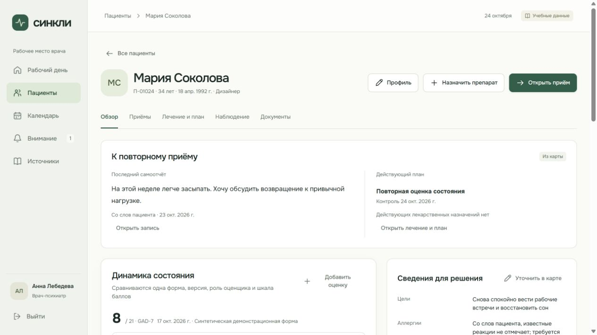
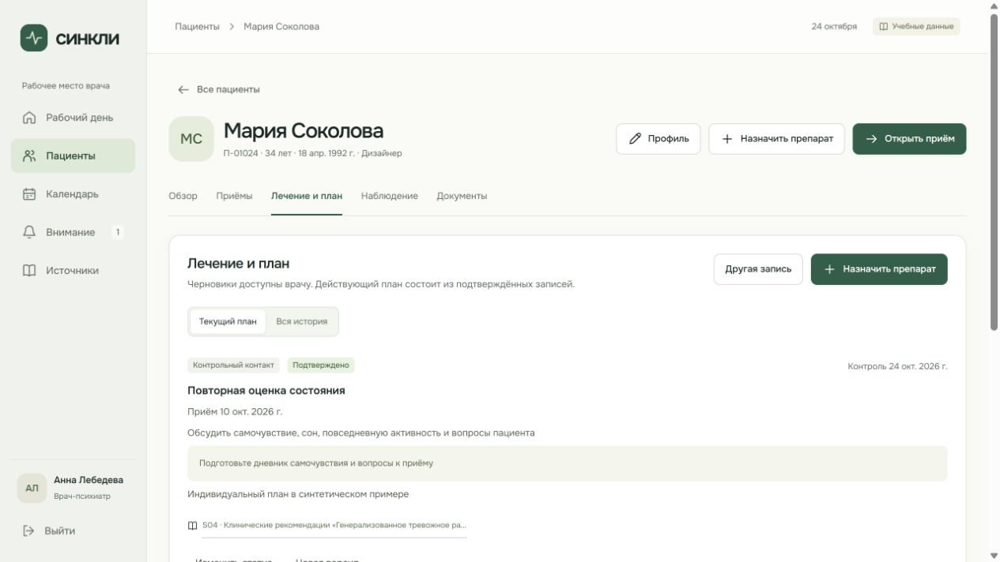
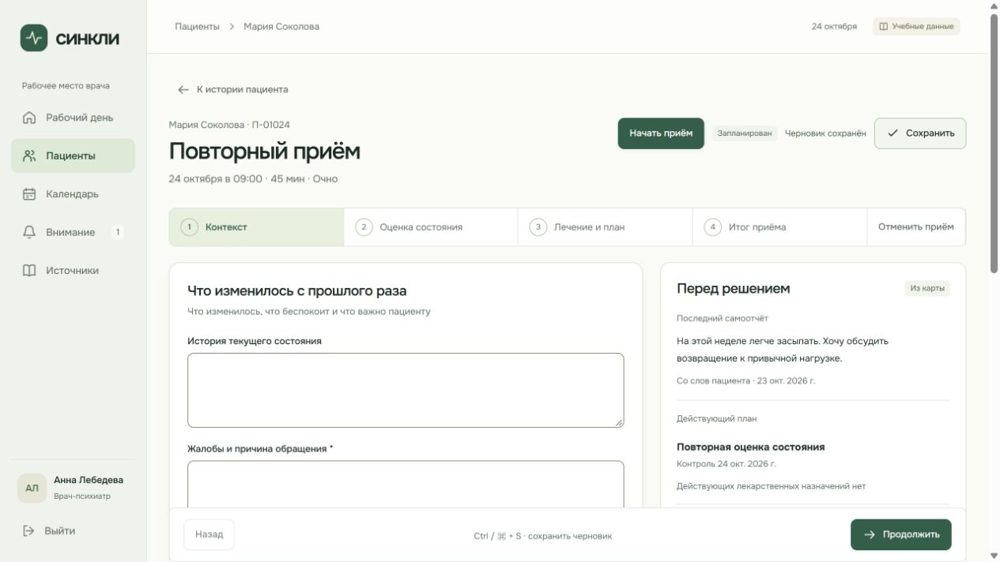
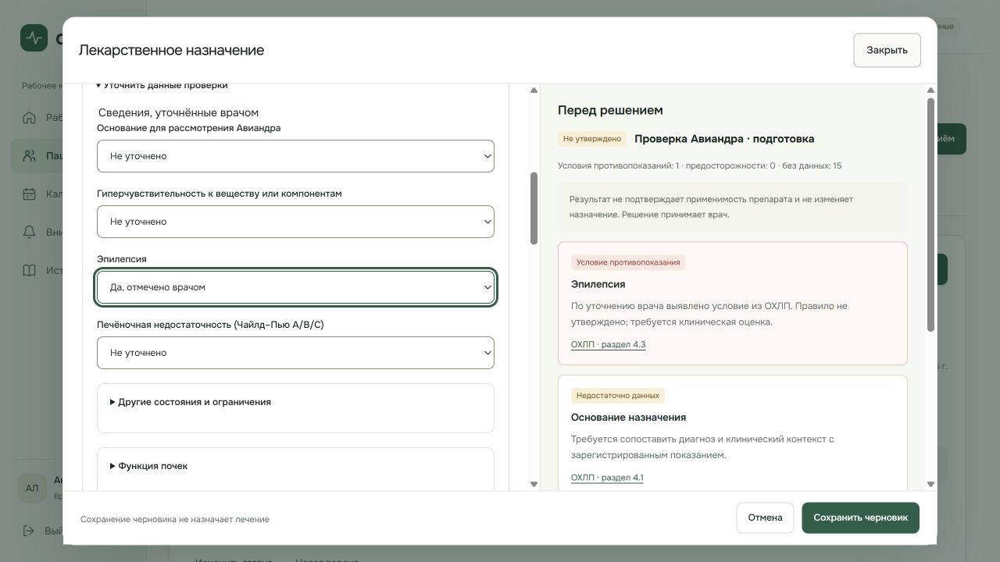
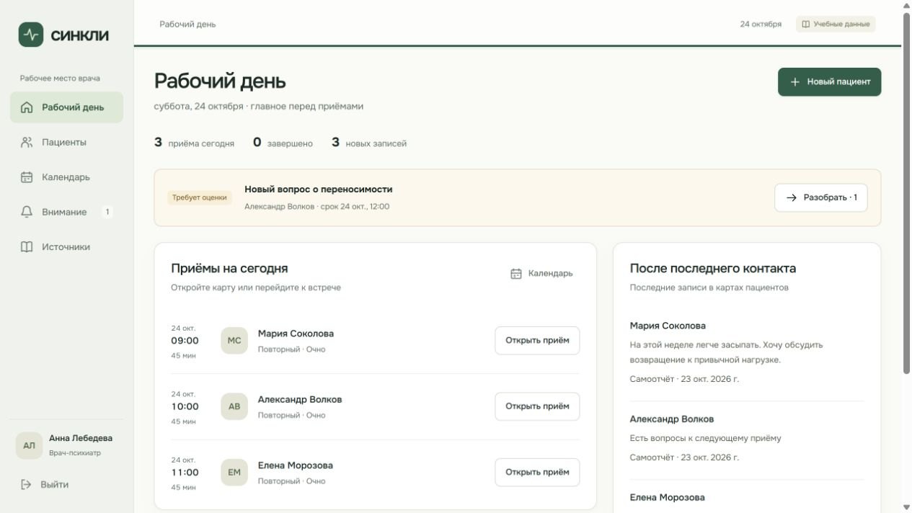
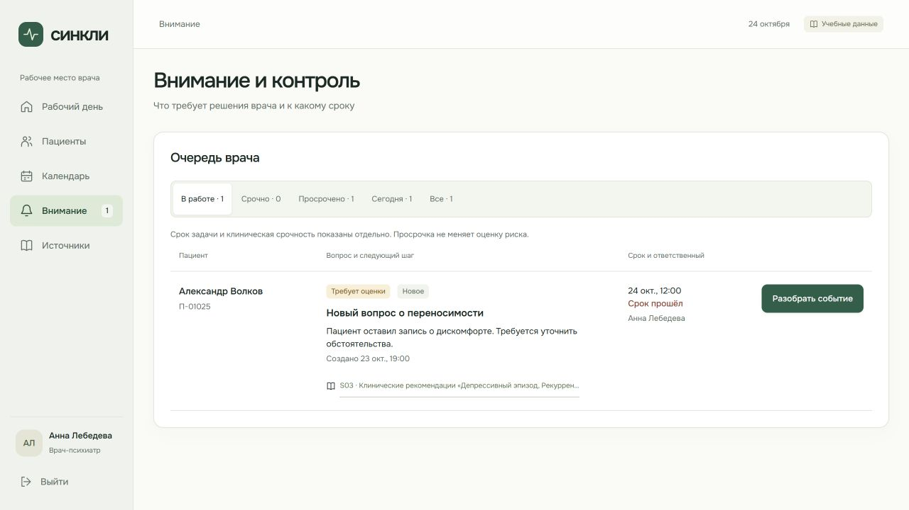
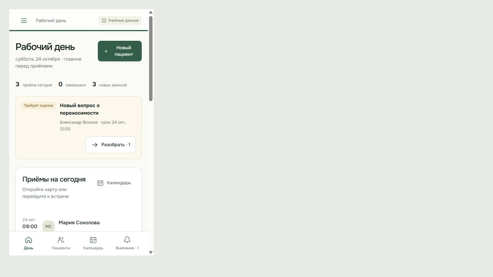
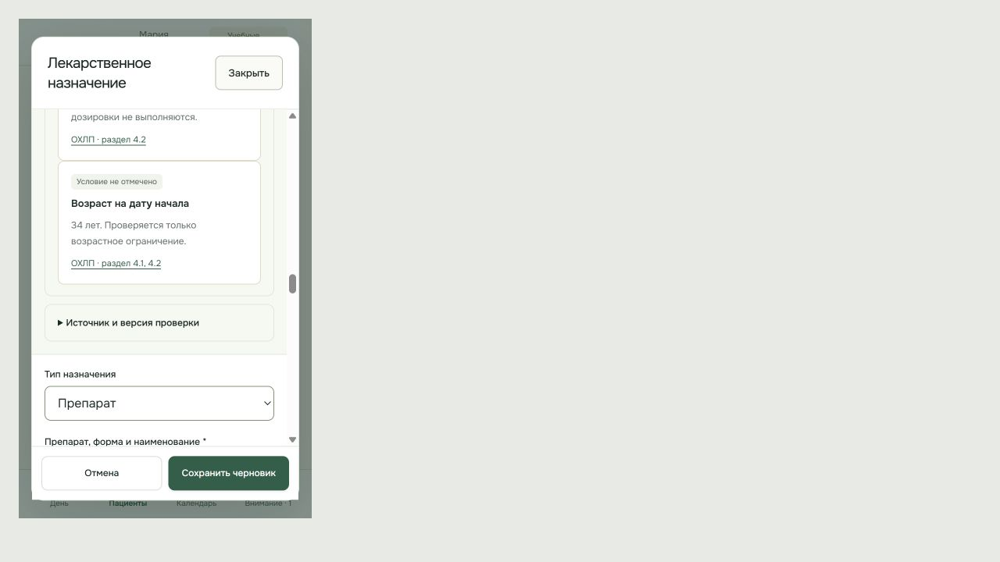

# Принятый интерфейс кабинета врача · 24 октября 2026

Основание: пользователь принял отдельный UX-прототип и поручил внедрение. Ветка `codex/p09-doctor-ux` от `origin/main` после принятого PR #29. Задача относится к P09, требованиям E03/T04, отображению F02/F04/M04. Исполнитель — агент по поручению владельца проекта. Публикация, merge и независимый approve этой проверкой не подтверждаются.

## Результат

- Карта: пять основных разделов, сводка перед решением и прямое назначение; существующий приём открывается вместо создания дубликата. Все прежние подразделы и URL сохранены.
- Общие сведения: один профиль и существующий аудит в карте, приёме и Авиандре; источник не выдумывается из даты изменения карты.
- Приём: горизонтальные этапы, два основных поля повторного визита, дополнительные сведения раскрываются, прошлые записи доступны рядом. Начало приёма и подтверждение остаются отдельными действиями.
- Назначение: широкий Radix-диалог, результаты существующей проверки рядом, сгруппированные поля, постоянные кнопки. На телефоне есть полный список оснований, прокрутка и доступ к форме.
- Рабочий день: внимание перед расписанием и мобильная навигация. Очередь врача показывает вопрос, срок, ответственного и действие; клиническая срочность отделена от срока задачи.

## Фактические проверки

| Проверка                                    | Результат                                                                                                                                                                                  |
| ------------------------------------------- | ------------------------------------------------------------------------------------------------------------------------------------------------------------------------------------------ |
| `npm run check`                             | Успешно: форматирование, ссылки, синтаксис лендинга и общая сборка                                                                                                                         |
| `npm run check:web`                         | Успешно: контракт, формы, TypeScript, 26 файлов / 180 тестов, сборки врача и администратора                                                                                                |
| `npm run check:fixtures`                    | Успешно: 4 файла / 61 тест, normal/empty/long соответствуют схеме                                                                                                                          |
| `node --check scripts/verify-doctor-ui.mjs` | Успешно; селекторы обновлены под принятую навигацию                                                                                                                                        |
| Вложенное сохранение профиля                | RED: лишняя команда plan.save; GREEN: только profile.update, назначение остаётся открытым, текст сохранён, контекст помечен устаревшим                                                     |
| Навигация и сроки                           | Проверены существующий приём, прямой лекарственный черновик, просрочка, нулевая срочная очередь, равенство срока текущему времени, сегодня и следующий день                                |
| Встроенный браузер                          | Осмотрены обзор, план, повторный приём, рабочий день, таблица событий и широкая панель Авиандра; Escape закрывает её и возвращает фокус к открывшей кнопке                                 |
| Телефон                                     | В основном приложении при viewport iframe 375 × 640 проверены внимание перед расписанием, переход в карту, открытие назначения и раскрытие всех 18 оснований; наложение колонок исправлено |

Скриншоты сняты с действующего приложения на localhost:8773, учебные данные. Мобильные снимки включают рамку временной страницы проверки. Это не макеты прототипа. Vite сообщает о существующих крупных чанках экспортных библиотек; сборки успешны.

## Ограничения и восстановление

API, БД, права, зависимости и медицинские правила не изменены. Авиандр остаётся `unapproved`, автоматический подбор и подтверждение лечения не добавлены. Миграции не требуются. Откат — revert изменений UX через отдельный PR.

Серверная интеграция, реальное устройство, скринридер и клиническая апробация в этой UX-итерации не проверялись. Полный CLI-сценарий `check:doctor:ui` обновлён, но не запускался; браузерные действия выполнены отдельно через встроенный браузер. Самопроверка агента не заменяет независимое ревью разработчика и клиническую валидацию.

## Скриншоты

## Дополнительная сверка с макетами

[Найденные пропуски, исправления и проверка всех показанных экранов](2026-10-24-doctor-ux-parity.md).
