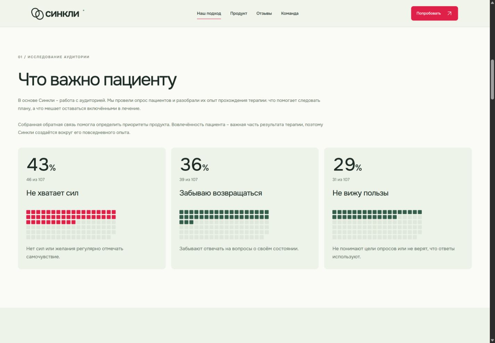
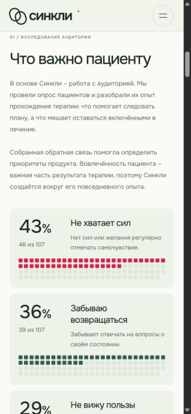
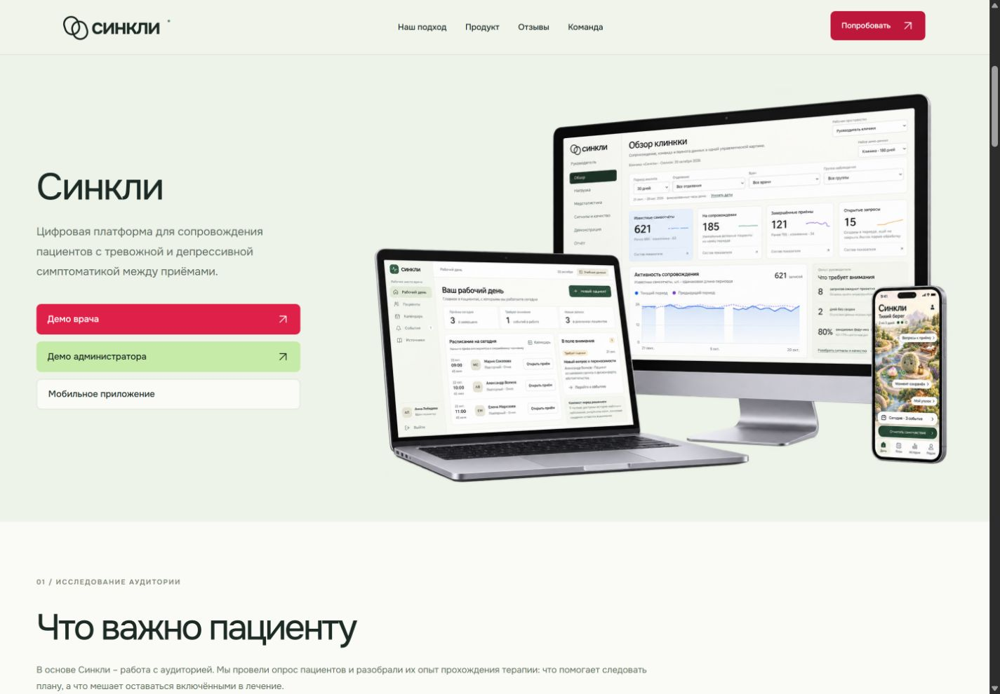
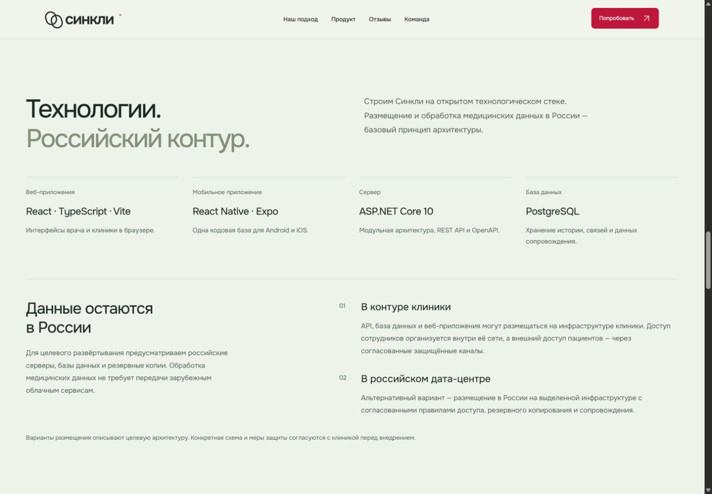
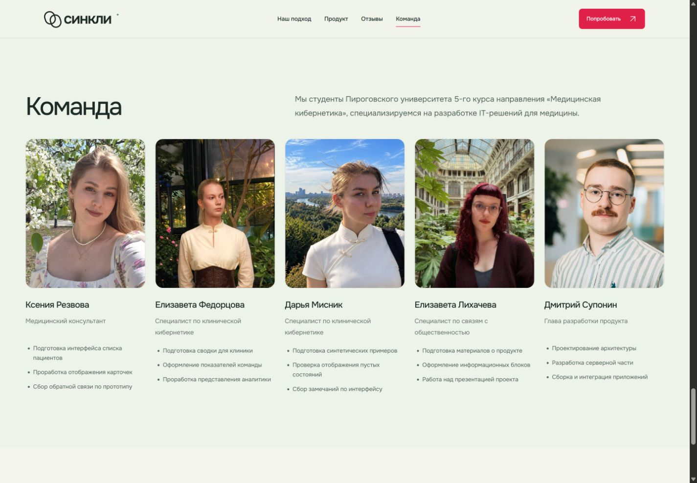
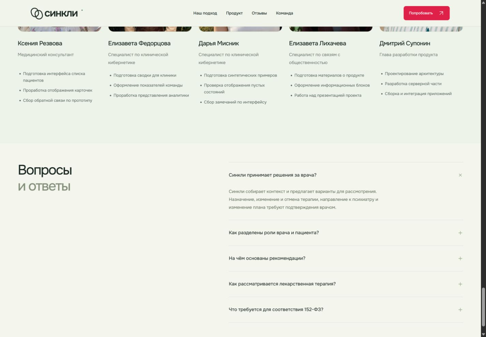

# Проверка обновления лендинга

Дата: 24 октября 2026 года. Ветка: `codex/landing-market-demo`. База: `origin/main` (`2d89f2e`). Проверял ИИ-агент; это не независимое одобрение контрибьютора.

## Результат

В PR входят согласованные в чате изменения лендинга: демо-навигация, вводный текст, компактные мозаики опроса, технологический блок, команда, рынок, монетизация, FAQ и чередование фонов. Анимация заполнения замедлена: задержка между клетками 28 мс вместо 12 мс, длительность одной клетки 200 мс; для 46 клеток суммарно 1540 мс с начальной задержкой 80 мс.

## Автоматические проверки

| Команда                  | Результат                                                                                      |
| ------------------------ | ---------------------------------------------------------------------------------------------- |
| `npm run check:web`      | Успешно: 23 файла, 162 теста; TypeScript, контракт, парсер форм, сборки врача и администратора |
| `npm run check:fixtures` | Успешно: 4 файла, 61 тест; normal, empty и long соответствуют схеме                            |
| `npm run check`          | Успешно: форматирование, Markdown-ссылки, синтаксис JavaScript, общая сборка                   |
| `git diff --check`       | Успешно                                                                                        |

Сборка предупреждает о чанках экспорта администратора больше 500 kB. Проверки не отключались. После переноса на актуальный `origin/main` в ветку не входят отдельные изменения и тесты админ-календаря; поэтому число веб-тестов — 162, а не 165 из прежней рабочей базы.

## Визуальные проверки

Проверены широкое окно 1440 × 1000 и мобильное 390 × 844:

- «Попробовать» ведёт к началу демосекции; видны согласованные подписи демо-кнопок.
- Заголовок «Что важно пациенту» и согласованное описание находятся над тремя мозаиками.
- В каждой мозаике 107 клеток, заполнено 46, 39 и 31. Проценты: 43%, 36% и 29%.
- Задержки последних клеток: 1340, 1144 и 920 мс; с длительностью заполнения 200 мс получаются 1540, 1344 и 1120 мс.
- Итоговая компоновка на телефоне не переполняет экран по ширине; карточки располагаются вертикально.
- Блок технологий, описание команды и раскрытие FAQ отображаются; у FAQ фон футера.

Обработчик `IntersectionObserver` снимает наблюдение после первого появления карточки. Итоговые стили без JavaScript и ветка `prefers-reduced-motion` проверены по коду; системную настройку уменьшения движения в этой проверке не переключали.

## Скриншоты

## Ограничения и воспроизведение

Результаты опроса — только согласованные агрегаты. Исходные анкеты, свободные ответы и контакты не включены. Вклады участников и модель монетизации — предварительное наполнение. Размещение в российском контуре описывает целевую архитектуру, а не выполненную проверку внедрения. Клиническая апробация не проводилась.

Запуск: `npm run dev -- --port 8767`. Для повторного просмотра заполнения обновить страницу и прокрутить до раздела опроса. На мобильном экране проверить карточки по мере прокрутки. Перед merge нужны связанная issue, независимое ревью другого контрибьютора и зелёные обязательные CI checks.
