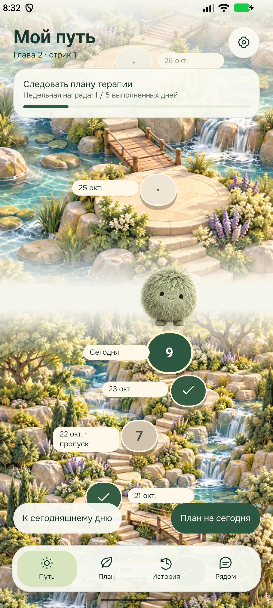
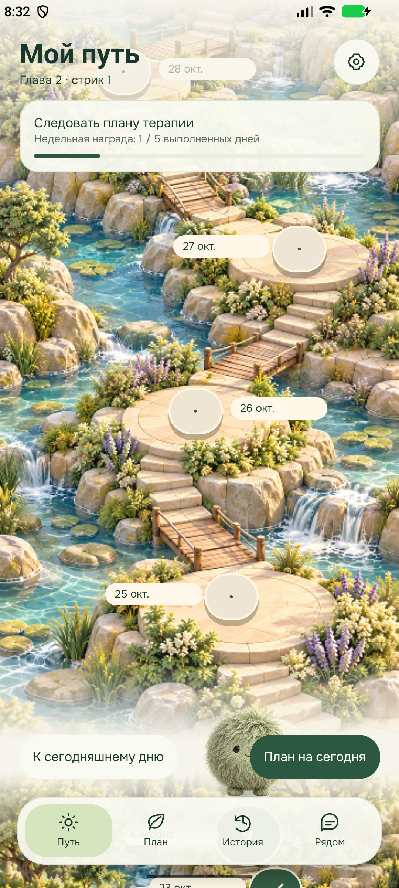

# Вертикальная карта пути: промежуточная проверка Android

Дата: 24 октября 2026. Ветка: `codex/22-patient-journey`. Это проверка отдельного этапа утверждённой [спецификации](../superpowers/specs/2026-10-24-patient-journey-design.md), а не подтверждение готовности всей версии APK.

## Реализовано

- Экран «Путь» использует настоящий вертикальный `ScrollView`, а не переключение неподвижных фоновых изображений.
- Каждая точка соответствует календарной дате. Выполненные и пропущенные дни сохраняются; сегодня выделено вместе со спутником. Показаны семь следующих дней.
- В синтетическом сценарии есть восемь прошлых дней. Движение по календарю не зависит от стрика. Закрытые игровые итоги читаются из сохранённого снимка дня.
- Нажатие на точку открывает дела выбранного дня; сегодняшняя точка позволяет перейти в план. Сверху отображаются личная цель, глава, стрик и прогресс недельной награды.
- Кнопка «К сегодняшнему дню» возвращает точную начальную позицию. Для первого открытия используется измеренная высота экрана.
- У крайних точек есть запас прокрутки относительно постоянного заголовка и нижней навигации. Подписи вынесены сбоку от точек.

## Фактические проверки

- `npm run check:mobile`: типизация и lint прошли, 44 теста прошли.
- `journey-map.test.ts`: календарные статусы восьми прошлых дней и сегодняшней точки; длинный путь из 116 уникальных дат; сохранение закрытого пропуска.
- `gradlew.bat :app:assembleRelease -PreactNativeArchitectures=x86_64 --console=plain`: `BUILD SUCCESSFUL`. Внутренняя сборка установлена поверх старой в эмуляторе `emulator-5570`, пакет `ru.syncli.patient.demo`.
- `node apps/mobile-patient/scripts/verify-journey-map.mjs`: жест меняет позиции точек; возврат восстанавливает исходные координаты; нажатие на сегодняшнюю точку открывает обязательные дела, окно закрывается. Первое выполнение выявило неверную стартовую позицию до измерения экрана; после исправления сценарий прошёл.
- Ошибок `ReactNativeJS:E` и `AndroidRuntime:E` в прочитанном журнале эмулятора не было.

## Границы этапа

Проверена светлая тема на одном Android-эмуляторе. Новые анимационные листы спутников, свободное обустройство мира, обновлённый онбординг и реальные уведомления ещё не приняты этой проверкой. Внутренний APK для x86_64 не является финальной сборкой для телефона. Клинические данные и связь с врачом синтетические.
