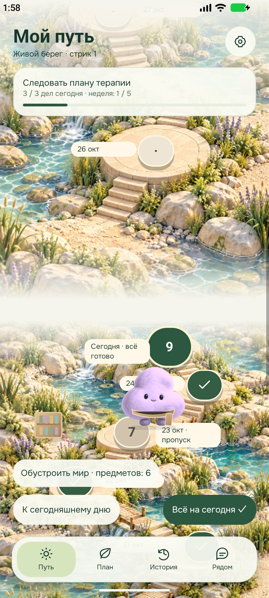
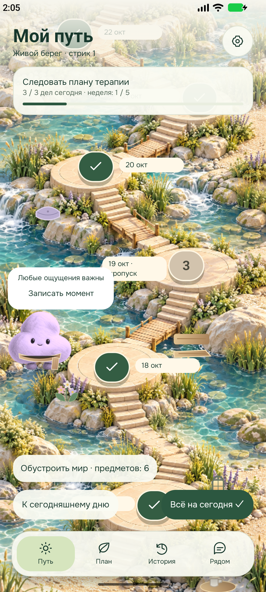
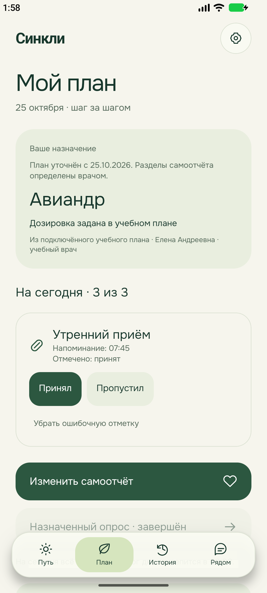

# Пациентское приложение 0.3.0: итоговая проверка

Дата: 25 октября 2026. Ветка: `codex/22-patient-journey`, рабочая папка: `D:\Projects\Psycho`. Владелец реализации — ведущий разработчик. Основание: [утверждённая спецификация](../superpowers/specs/2026-10-24-patient-journey-design.md) и [план](../superpowers/plans/2026-10-24-patient-journey.md).

## Поставка

Локальная release-сборка `artifacts/syncli-patient-0.3.0.apk`, 90 883 928 байт. Версия `0.3.0`, versionCode `3`, пакет `ru.syncli.patient.demo`, Android 7.0/API 24 и выше, target API 36. ABI: `arm64-v8a`, `x86_64`. Metro и сеть для запуска не нужны.

SHA256 APK: `54eb1f4d99ac1337dba7bd27bec04cf51fefb3b1ecdeba9e21caf7961c94e64c`.

SHA256 сертификата: `fac61745dc0903786fb9ede62a962b399f7348f0bb6f899b8332667591033b9c`. Подпись локальным Android Debug сертификатом сохранена для обновления прежнего пакета. Это сборка для проверки владельцем, не публикация в магазине. APK и контрольная сумма находятся в игнорируемом `artifacts/`.

## Поведение

«Мой путь» — настоящая вертикальная календарная карта. Жест прокручивает дни; выполненные и пропущенные даты сохраняются. Есть точный возврат к сегодняшней точке, ближайшее обязательство и переход к нему. Перемещение предмета захватывает жест только в явном редакторе мира.

Добавлены восемь шагов онбординга, код или вход в демо-режиме, личная цель, недельная награда, две территории, 20 видов предметов, 12 достижений и независимые гардеробы двух спутников. У спутников 12 состояний, смена кадров, прогулки и взаимодействия с предметами. Карта ощущений меняет выражение лица, цвет и свечение, поддерживает виброотклик и кнопочную альтернативу.

День требует всех приёмов, полного назначенного самоотчёта и назначенных тестов. Закрытие строго в местные 00:00. Исторические правки сохраняют клинические факты, но не восстанавливают закрытый стрик. Открытые территории, предметы и награды сохраняются. Результаты и ответы тестов не показываются пациенту и не включаются в его выгрузку.

## Матрица приёмки

«Проверено» ниже относится к синтетическому сценарию и указанным проверкам, а не к реальной клинической эксплуатации.

| Требования | Результат и доказательства                                                                                                                                                                                                                                                                                                                                                                                                                                                                                             |
| ---------- | ---------------------------------------------------------------------------------------------------------------------------------------------------------------------------------------------------------------------------------------------------------------------------------------------------------------------------------------------------------------------------------------------------------------------------------------------------------------------------------------------------------------------- |
| A01–A02    | Проверено: новый изолированный Android-профиль, код/ошибка/демо, восемь шагов, тема/спутник/цель/время после перезапуска. `mobile-fresh/onboarding-result.json`.                                                                                                                                                                                                                                                                                                                                                       |
| A03–A04    | Проверено: восемь прошлых дат и сегодня, стабильный seed, исходный стрик 1/сад/награда — тесты сценария; нативные переходы и вертикальный жест. `verify-journey-map.mjs`, `mobile-journey-world/world-result.json`.                                                                                                                                                                                                                                                                                                    |
| A05–A10    | Проверено поведенческими тестами: обязательства, неизвестный/пропущенный приём, полночь/зоны/откат времени, поздние правки, отмена предварительного зачёта, награда 5/7 без дублей. На свежем Android выполнены приём, полный отчёт и PHQ-9: «3 из 3». `mobile-fresh/day-native-result.json`.                                                                                                                                                                                                                          |
| A11        | Проверено: свободное размещение, поворот/масштаб, границы, сохранение после остановки, отмена черновика, независимые гардеробы. `verify-world.mjs`, `verify-wardrobe.mjs`.                                                                                                                                                                                                                                                                                                                                             |
| A12        | Проверено: 12 состояний обоих спутников, реальные отличия кадров, одежда, три реакции на предметы; нативное видео и расчёт крайних фаз. См. [проверку спутников](2026-10-25-mobile-companions.md).                                                                                                                                                                                                                                                                                                                     |
| A13        | Проверено: версии обязательных полей, необязательный момент отдельно, сохранение черновика. Полный сегодняшний отчёт из пяти разделов заполнен на Android.                                                                                                                                                                                                                                                                                                                                                             |
| A14        | Полные русские GAD-7/PHQ-9 упакованы по [паспортам источников](../specifications/doctor-web/2026-10-24-patient-questionnaire-passports.md). PHQ-9: девять вопросов, условный вопрос, восстановление черновика после остановки, только подтверждение завершения — нативный PASS. Сверка форм и обязательность — автоматические тесты. Клиническая активация для реальных пациентов отдельно.                                                                                                                            |
| A15        | Проверено: история/календарь/графики/правки/удаление, 500 записей в тестах, настоящие JSON/PDF через системное сохранение; обе страницы PDF просмотрены. `mobile-journey-care/`. Числовая детализация журнала исправлений ограничена, см. ниже.                                                                                                                                                                                                                                                                        |
| A16        | Проверено в моделируемом сценарии: переносимость, два варианта обращения, вопросы и сведения о визите; нет ложного утверждения об отправке врачу.                                                                                                                                                                                                                                                                                                                                                                      |
| A17        | **Физический Android не проверен:** телефон не подключён. На эмуляторе уведомление приходит при закрытом процессе, выключенном экране и активной блокировке; фоновое «Принял» сохраняется без открытия приложения. Требуется проверка владельцем на телефоне.                                                                                                                                                                                                                                                          |
| A18        | Отзыв разрешения уведомлений и отказ точного доступа показаны в интерфейсе; `mobile-fresh/permission-native-result.json`. Перезагрузка и фоновое действие проверены на эмуляторе. Первый управляющий сценарий потерял ADB; после реальной загрузки проверено уже доставленное задание без повторного планирования, затем выполнено действие. Дубли исходного/отложенного уведомления, устаревшие действия — транзакционные тесты. После Android force-stop нужно ручное открытие, восстановление расписания проверено. |
| A19        | Проверено: миграция, повтор/ошибка, архив и настройки, обновление APK поверх прежнего пакета. Старые записи не очищаются.                                                                                                                                                                                                                                                                                                                                                                                              |
| A20–A21    | Проверено: три темы, 960×1920, шрифт 1.3, гардероб, отключение игры, кнопочный выбор ощущений, системное уменьшение движения, выключатель вибрации и отсутствие буквальных `\n`. Служба TalkBack включена и проверен базовый фокус; звуковой вывод и весь маршрут с диктором не аудированы. Полная приёмка с экранным диктором и ощущение вибрации на физическом телефоне остаются проверкой владельца.                                                                                                                |
| A22        | Универсальная release-сборка собрана, установлена обновлением, запущена без Metro/сети. Версия, подпись, размер и хэш приведены выше; скриншоты и нативная запись сохранены.                                                                                                                                                                                                                                                                                                                                           |

## Проверки и доказательства

- `npm run check`: PASS, форматирование, ссылки, синтаксис и общая web-сборка; остаются предупреждения Vite о больших chunks. Журнал: `artifacts/final-root-check.log`.
- `git diff --check`: PASS.
- `npm run check:mobile`: TypeScript, ESLint, 84/84 теста, без пропусков. Журнал: `artifacts/final-mobile-check.log`.
- Gradle `:app:assembleRelease -PreactNativeArchitectures=arm64-v8a,x86_64 --console=plain`: `BUILD SUCCESSFUL`, 439 задач, 34 секунды. Журнал: `artifacts/journey-final-build.log`.
- `apksigner verify --print-certs`: подпись корректна; `aapt dump badging`: пакет/версия/API/ABI проверены.
- `verify-journey-map.mjs`: PASS на окончательном APK, вертикальный жест и точный возврат.
- `verify-android.mjs`: PASS на окончательном APK, история без игровых статусов при отключённой игре, кнопочная альтернатива, версия и переносы строк.
- `verify-final-ui.mjs`: PASS — три темы, компактный экран/шрифт 1.3, модальное обустройство, отключение игры/вибрации, холодный запуск офлайн.
- `verify-full-questionnaire.mjs`: PASS на новом профиле, полный PHQ-9 и восстановление черновика после остановки процесса.
- `verify-notifications.mjs`: PASS при закрытом процессе, погашенном экране и блокировке. `verify-post-reboot-action.mjs`: PASS после реальной перезагрузки. Метаданные: `artifacts/mobile-final/`.
- Запись настоящего движения: `artifacts/mobile-companions/companions-native.mp4`, 45 секунд. Пары кадров всех 12 состояний отличаются в области тела; проверены 24 изображения и слои одежды. Предварительный просмотр предъявлен до поставки APK.

## Решения, ограничения и продолжение

Реальная связь с врачом, отправка обращений и серверная синхронизация моделируются. Авиандр присутствует как учебный план без выдуманной дозировки. Приложение использует только синтетические данные. Клинические пороги, диагностика и автоматическое изменение терапии не активированы; врачебная валидация и эксплуатационные процедуры остаются отдельным условием реального применения.

Android хранит расписание на ближайшие 28 дней, максимум 60 заданий; оно обновляется при открытии приложения. Это не бесконечная доставка без запуска. Разрешения, энергосбережение производителя и принудительная остановка могут влиять на доставку. Проверка конкретного телефона обязательна.

В журнале исправлений отображаются статус и заметка, но пока не развёрнуты все изменения числовых полей/точного времени. Исходные неизменяемые ревизии сохраняются, актуальные значения и графики обновляются. Это оставленное некритичное замечание.

Проведён один обзор всей ветки AI-рецензентом: критических замечаний 0; три существенных и дополнительно повышенная до существенной гонка двух уведомлений исправлены за один проход. Четыре регрессионных сценария воспроизведены RED → GREEN. AI-обзор не является независимым одобрением участника команды. Публикация/PR/слияние не выполнялись. Сторонние изменения `site/index.html` и `site/styles.css` не включаются в мобильную поставку.

Для отката исходников используется предыдущий коммит ветки. Понижение установленного Android-приложения может быть запрещено системой; не удаляйте приложение ради отката, если нужно сохранить историю. Перед реальным использованием требуется отдельная стратегия миграции и резервирования.

## Скриншоты окончательного APK

