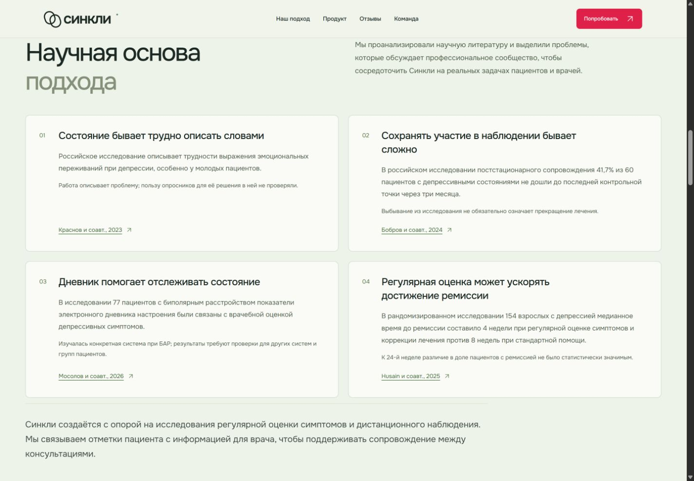
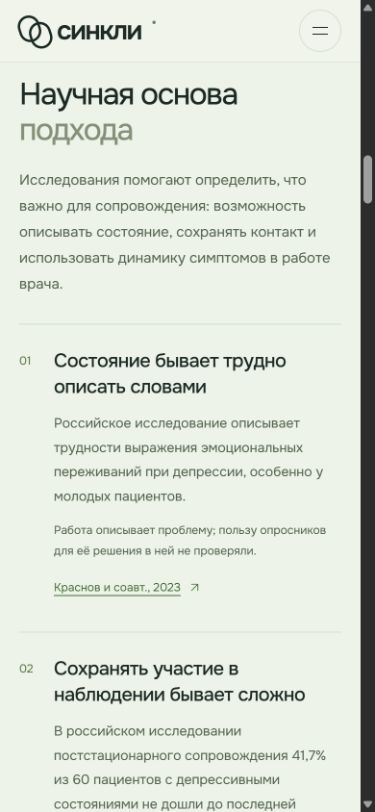

# Научная основа: карточки 2 × 2

> **Статус документа:** Историческое свидетельство: результаты и ограничения относятся к указанной ниже дате и версии. Они не являются текущим статусом всего продукта. [Текущее состояние](../status.md).

24 октября 2026 года. Ветка `codex/landing-content-refresh`. Изменения лендинга: научный раздел, описание опроса, тексты экосистемы и FAQ, подпись инфраструктуры; без изменений клинической логики.

## Содержание и источники

После варианта «Редакционные строки» пользователь выбрал карточки в сетке 2 × 2; на телефоне — одна колонка. Вступление переписано о проведённом анализе литературы и фокусе на реальных задачах. Сохранены четыре тезиса, основной текст, ограничения, вывод и ссылки в том же порядке:

1. [Краснов и соавт., 2023](https://doi.org/10.17116/jnevro202312311230): трудности выражения эмоциональных переживаний; польза опросников в этой работе не проверялась.
2. [Бобров и соавт., 2024](https://psychiatr.ru/files/magazines/2024_12_scp_2475.pdf): 41,7% из 60 участников не дошли до последней контрольной точки; отсев не означает прекращение лечения.
3. [Мосолов и соавт., 2026](https://doi.org/10.48612/psyph/14gz-nazk-r2re): конкретная система, 77 пациентов с БАР; переносимость результата требует проверки.
4. [Husain и соавт., 2025](https://doi.org/10.1001/jamanetworkopen.2025.29427): 154 взрослых, медиана времени до ремиссии 4 против 8 недель; к 24-й неделе различие долей ремиссии статистически незначимо.

Это редакционная проверка ссылок и соответствия утверждённому тексту. Клиническая валидация и клиническое исследование Синкли не проводились; перед публикацией клинического содержания требуется проверка клиницистом по правилам репозитория.

## Проверка

- `npm run check`: успешно, форматирование, Markdown-ссылки, синтаксис JS и сборка. Сохраняется предупреждение о чанках экспорта администратора больше 500 kB.
- `npm run check:web`: успешно после переноса на актуальный `origin/main` (`c81e57e`), 26 файлов / 181 тест, контракт, парсер, TypeScript и сборки веб-приложений.
- `git diff --check`: успешно.
- В браузере проверены 1440 × 1000 и 390 × 844; дополнительно на ширине 320 px горизонтального переполнения нет. На телефоне текст и ссылка находятся под заголовком, порядковый номер сохраняется слева.
- Проверены порядок четырёх тезисов и адреса всех четырёх ссылок. Ссылки открываются в новой вкладке с `noopener noreferrer`. По запросу пользователя удалены подписи о будущем клиническом исследовании и согласовании размещения с клиникой. Описание опроса перенесено вправо от заголовка, на телефоне — под него.

## Скриншоты

Миграции, зависимости и настройки не требуются. Откат: revert коммита с заменой блока и повторная проверка сборки.
