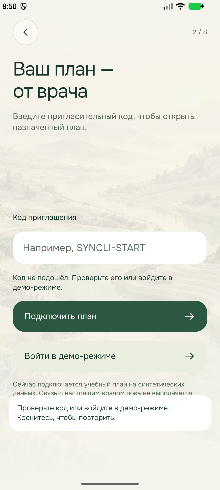
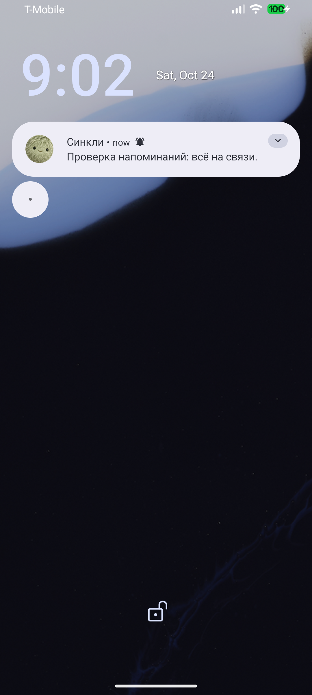
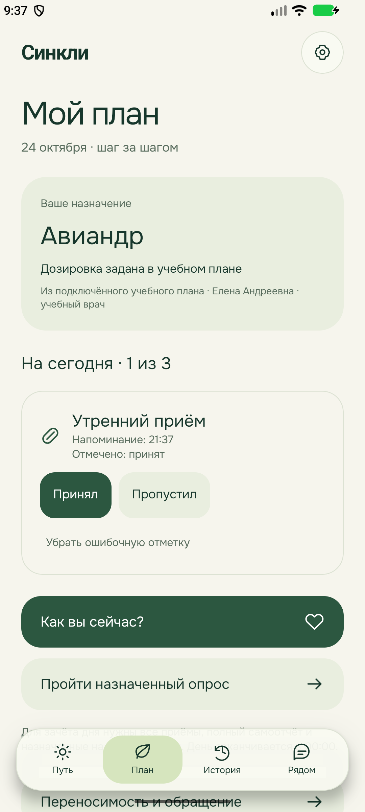

# Онбординг и локальные уведомления: промежуточная проверка

Ветка `codex/22-patient-journey`, [утверждённая спецификация](../superpowers/specs/2026-10-24-patient-journey-design.md). Это промежуточный этап, не итоговая приёмка APK.

## Подключение и знакомство

Восемь шагов: приветствие → код/демо-вход → назначенный учебный план → спутник → тема → имя и цель → время и разрешения → правила пути. Пустой и неверный код не открывают план. Единственный подготовленный код `SYNCLI-START` нормализуется по регистру и внешним пробелам; кнопка «Войти в демо-режиме» использует тот же обработчик. Повторное подключение не пересоздаёт профиль, мир или историю. Полная медицинская анкета не является условием входа.

`verify-onboarding.mjs` прошёл на Android-эмуляторе: пустой код, демо-вход, Авиандр, выбор облачка, тема, личная цель, время `07:45`, завершение знакомства и сохранённое время в настройках. Отказ от запроса разрешения не мешает завершить знакомство. Стартовые окраски и практические действия редактора ещё зависят от этапа интеграции спутников и мира.

## Уведомления

Используются `expo-notifications@55.0.27`, `expo-task-manager@55.0.20` и небольшой локальный Android-модуль `modules/syncli-alarm`. Он только проверяет доступ к точным будильникам и открывает соответствующий системный экран. Общая логика назначения, дня и сохранения остаётся в TypeScript.

Настройки отдельно показывают разрешение уведомлений и точного времени, позволяют менять часы приёма и самоотчёта и назначать проверочный сигнал через 15 секунд. Схема и количество приёмов не изменяются. Локальное расписание строится на 28 дней вперёд, обновляется при возврате и изменении настроек, ограничено 60 ближайшими заданиями для совместимости с платформами. При долгом отсутствии после этого горизонта расписание нужно обновить открытием приложения; бессрочная доставка этим этапом не подтверждена.

Уведомление связано с датой, слотом и версией плана. Изменение времени заменяет прежний сигнал. Двойное действие не дублирует факт; сигнал прошедшего дня или другого назначения не восстанавливает стрик. Перенос на 15 минут не меняет схему и не переходит через полночь. Переход летнего времени проверяется отдельно, включая несуществующий час.

Фактические проверки:

- `npm run check:mobile`: типизация, lint и 56 тестов прошли.
- `npm run check`: форматирование, Markdown-ссылки, синтаксис сайта и общая веб-сборка прошли.
- Чистая `npm ci --ignore-scripts` прошла в изолированной копии манифестов/lockfile: 1314 пакетов, 48 секунд. В основном `node_modules` команда встретила `EPERM` на используемой Windows-библиотеке Rolldown; действующий веб-процесс не прерывался. Зависимости рабочего каталога восстановлены через `npm install --ignore-scripts`, посторонние версии lockfile не изменены.
- `gradlew.bat :app:assembleRelease -PreactNativeArchitectures=x86_64 --console=plain`: сборка успешна; обновление установлено через `adb install -r`.
- `verify-notifications.mjs`: процесс завершён **до** назначенного сигнала, Android доставил уведомление без него; подтверждено состояние `KeyguardServiceDelegate showing=true`. Доступ `SCHEDULE_EXACT_ALARM: allow`. Настройка блокировки эмулятора восстановлена.
- `verify-notification-action.mjs`: реальное уведомление о приёме в назначенную минуту, процесс завершён до доставки; «Принял» обработан без открытия приложения, после запуска в Плане сохранена отметка. Проверка первоначально выявила открытие приложения, затем несовпадение сырого формата Android. Исправлены ранняя регистрация задачи через `index.ts` и разбор `content.dataString`; добавлен регрессионный тест вместе с поддержкой обычного `content.data`.

Проверки проведены на эмуляторе, не на физическом телефоне. Финальные проверки перезагрузки, отзыва разрешений, переноса из системного уведомления и ограничений force-stop ещё не закрыты. После принудительной остановки через настройки Android требуется повторный запуск приложения. Особенности платформы описаны в [Android alarms](https://developer.android.com/develop/background-work/services/alarms) и [Expo SDK 55 notifications](https://docs.expo.dev/versions/v55.0.0/sdk/notifications/); сами ссылки не доказывают работу приложения.
