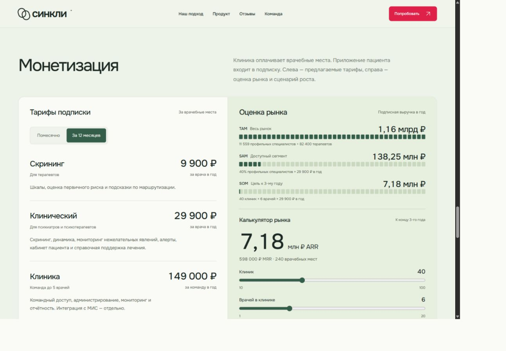
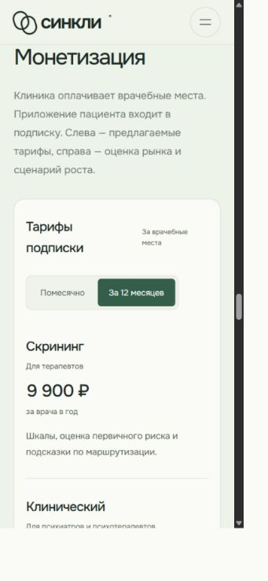

# Монетизация Тарифы и калькулятор рынка

25 октября 2026 года. Ветка `codex/landing-monetization`, основа `origin/main` — `75d7968`. Изменён только раздел монетизации, его логика, стили, проверки и документация. Отдельный блок «Рынок» и редизайн не затронуты.

## Данные и поведение

Источник — предоставленный пользователем файл `syncli_market_and_unit_economics_2026.docx`. Исходный DOCX не изменён и не включён в репозиторий. Слева — три тарифа и переключение помесячной/годовой оплаты. Справа — оценки TAM/SAM/SOM и два ползунка. Приложение пациента включено в предложение клиники.

Точные расчёты: TAM 1 161 374 100 ₽/год; SAM 138 245 640 ₽/год; исходный SOM 7 176 000 ₽ ARR к концу третьего года (40 клиник × 6 мест × 29 900 ₽/год), эквивалент MRR 598 000 ₽. Доля доступности 40% — допущение документа. ARR не равен накопленной выручке за три года. При изменении любого ползунка одновременно обновляются SOM, ARR, MRR, число мест и подписи. Годовая основа калькулятора независима от переключателя просмотра тарифов.

Рыночные формулы, источник численности и допущение 40% доступны в раскрывающемся пояснении. Внешние источники отдельно не проверялись: задача — перенос модели из документа. Тарифы сохраняют статус предложения, не подтверждены готовностью платить. Ранее удалённые общая подпись об условной модели, метка «Условный сценарий» и кнопки повтора анимации не возвращены.

Клетки заполняются при появлении раздела, интерактивные обновления происходят сразу. CSS учитывает reduced motion; отдельная системная настройка не переключалась. Без JS доступны исходные цены и оценки, интерактивные элементы отключены.

## Проверка

- Целевые проверки калькулятора и лендинга: 2 файла / 3 теста, успешно. Покрыты все месячные и годовые цены, независимость годового калькулятора от просмотра тарифов, крайние и промежуточные комбинации двух ползунков, ARR/MRR и точные доли диаграмм.
- `npm run check` — успешно: форматирование, Markdown-ссылки, синтаксис и сборка.
- `npm run check:web` — успешно: контракт, парсер, TypeScript, 28 файлов / 186 тестов и сборки веб-приложений.
- В браузере проверены месячные и годовые цены, клавиатурное управление двумя ползунками и восстановление исходного сценария 40 × 6.
- Проверены фактические ширины 1309, 354 и 320 CSS px; переполнения нет. На узком экране части идут последовательно. Скриншоты обновлены.
- `git diff --check` — успешно. Сохраняется предупреждение о чанках экспорта администратора больше 500 kB.

## Скриншоты

Новые зависимости, миграции и настройки не требуются. Откат — revert изменений монетизации. API, клиническая логика и приложения не менялись. Публикация PR ожидает просмотра пользователем.
