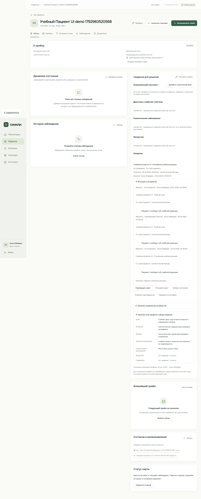

# Проверка единого клинического контекста — 26 октября 2026

> **Статус документа:** Историческое свидетельство: результаты и ограничения относятся к указанной ниже дате и версии. Они не являются текущим статусом всего продукта. [Текущее состояние](../status.md).

Ветка `codex/doctor-major-update`. [Область реализации и API](../clinical-context.md), [план MI01](../superpowers/plans/2026-10-26-clinical-context.md). Использованы только синтетические карты, отдельная локальная PostgreSQL и учебный режим браузера. Это техническая проверка хранения и решений врача, не клиническое утверждение правил.

## Подтверждённые сценарии

- Все четыре категории сохраняют значение и происхождение независимо от статуса подтверждения. Диагнозы/соматика используют МКБ-10, лекарства — регистрационный снимок ГРЛС. Подтверждение факта приёма лекарства не меняет план и назначения.
- Врач подтверждает сведения отдельной командой; автор и время берутся из сессии API. Подмена подтверждения клиентом, чужой документ и несуществующая цитата отклоняются. Подтверждение диагноза требует полномочия психиатра.
- Исправление требует причины, добавляет новую непроверенную версию и сохраняет прежние данные. Противоречие и перевод в историю также требуют причины. Неизвестное значение не превращается в отсутствие аллергии.
- Повтор команды не создаёт версий-дублей. Конфликт ревизии карты или версии факта отклоняется. Неактуальная запись сохраняется без возможности незаметного повторного подтверждения.
- Перенос старой записи сохраняет исходный снимок, остаётся непроверенным и не дублируется после структурирования. Изменение структурированного источника замечается даже при прежнем отображаемом тексте.
- Отдельное чтение PostgreSQL возвращает всю историю и источники. Снимок контекста совпадает в локальном домене и API; изменение факта делает прежнюю подготовительную проверку лекарства устаревшей.
- Браузерный сценарий блокировал запросы `**/api/**`: факт создан, подтверждён, прочитан после перезагрузки и исправлен; доступны все три версии и исходная цитата. Остальные сценарии кабинета, клавиатуры и узкого экрана также проверяются этим скриптом.

## Команды и результаты

| Команда                                                                    | Результат                                                          |
| -------------------------------------------------------------------------- | ------------------------------------------------------------------ |
| `npm run build:doctor:api`                                                 | Успешная сборка, 0 предупреждений и ошибок                         |
| `node scripts/verify-doctor-api.mjs` через изолированный локальный harness | 52 HTTP-проверки проходят, PostgreSQL `doctor_icd10_1792983454111` |
| `DOCTOR_UI_MODE=demo node scripts/verify-doctor-ui.mjs`                    | 12 этапов проходят без API                                         |
| `npm run check:fixtures`                                                   | 61 тест, 4 файла, проверка трёх наборов данных                     |

Дополнительно выполнены:

- `npm run check:web`: контракт, подготовка форм и TypeScript проходят; стандартный параллельный прогон остановился на двух тайм-аутах по 5 секунд в неизменённых административных/общих UI-тестах. Повтор полного набора `npx vitest run --project web --project tools --maxWorkers=2` — **225 тестов, 38 файлов, все проходят**, без увеличения тайм-аутов или изменения тестов администратора.
- Отдельные `npm run build --workspace @psycho/web-doctor`, `npm run build --workspace @psycho/web-admin`, `npm run site:check`, `npm run build` проходят. Сборщик сохраняет предупреждение о крупных web-чанках.
- `npm run check`: форматирование проходит, документация блокирует общий процесс. Финальный `npm run docs:check` показывает **12 прежних битых ссылок** в игнорируемых `artifacts/patient-main-pr.md` и `artifacts/v04-build/site/README.md`. Проверка новых/изменённых документов отдельным `remark ... --frail --no-stdout --quiet` проходит. Проверки не ослаблены.
- `git diff --check` проходит.

Для HTTP-сценария нужны запущенный API и отдельная пустая локальная PostgreSQL, одинаковое подключение в API и проверке, `DOCTOR_API_TEST_URL`. Пароли в результат не выводятся. Существующая БД не сбрасывалась; временный API остановлен после проверки. [Инструкция запуска](../doctor-workspace-runbook.md).

Технический review исправления переноса выполнен отдельным агентом; оставшихся существенных замечаний в этом объёме не выявлено. Это не независимое одобрение участника команды и не разрешение на активацию клинических правил. Мобильный ввод, автоматическая маршрутизация и реальные данные не входят в проверку.
