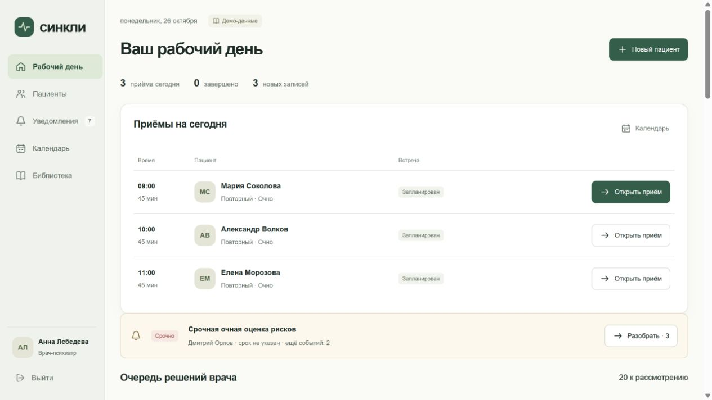
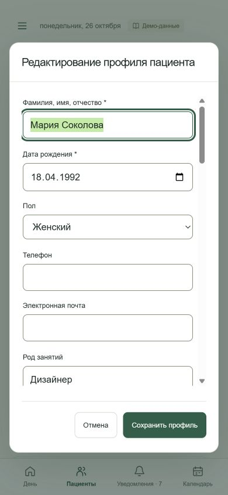
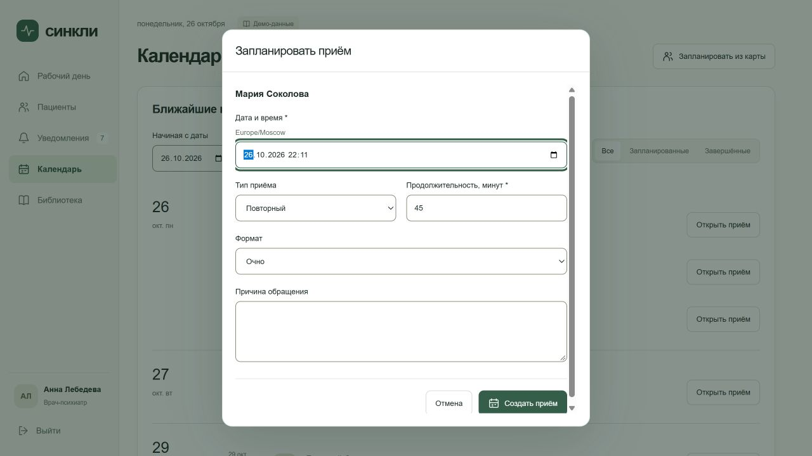
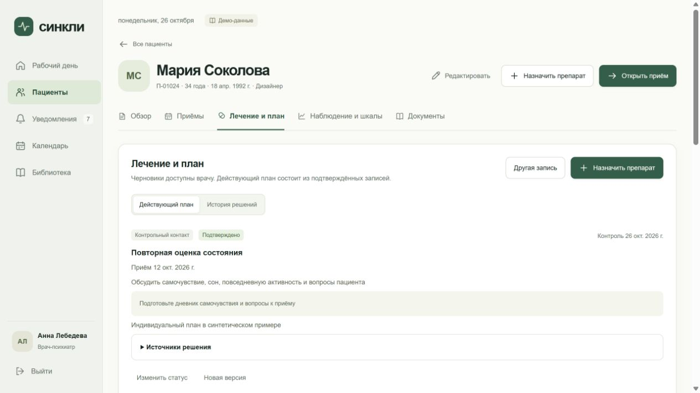
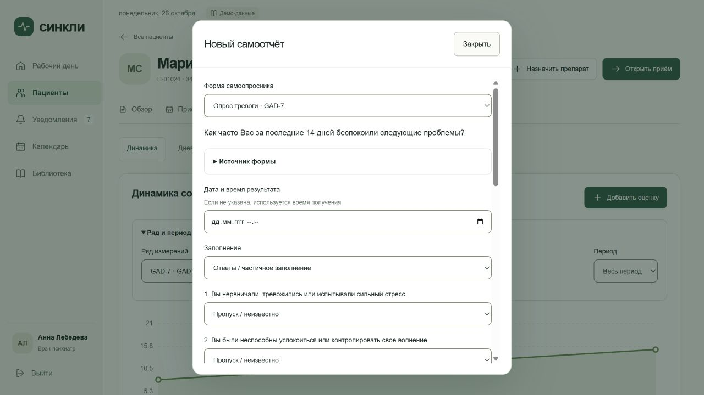
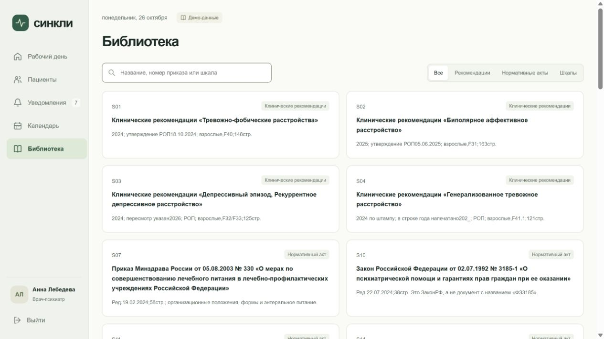

# Кабинет врача: согласованные правки интерфейса

Задача: [#48](https://github.com/souponin-d/psycho/issues/48). Ответственный: souponin-d. Основание: список правок и уточнения пользователя 26 октября 2026 года. [План](../superpowers/plans/2026-10-26-doctor-ui-refinement.md).

## Реализованный объём

| Область              | Результат                                                                                                                                                                                                                                                                                                            |
| -------------------- | -------------------------------------------------------------------------------------------------------------------------------------------------------------------------------------------------------------------------------------------------------------------------------------------------------------------- |
| Общая оболочка       | Убраны отдельная верхняя полоса и повтор названия экрана. Дата и режим находятся в содержимом. Локальный режим — «Демо-данные», серверный — «Клиника».                                                                                                                                                               |
| Рабочий день         | Сегодняшние приёмы расположены выше очереди рекомендаций.                                                                                                                                                                                                                                                            |
| Вкладки карты        | Клиническая поддержка и рекомендации доступны в обзоре. План больше не повторяет их; остаются проекты/принятые решения, лекарства, приверженность, контакты и направления. Для связанного проекта есть переход к рекомендации.                                                                                       |
| Возраст              | 18–120 лет включительно: HTML-границы, локальная модель и API; создание и редактирование, включая дни рождения. Старые записи не удаляются.                                                                                                                                                                          |
| Профиль              | «Редактировать», новое название диалога, жалобы → анамнез → семейный/частные анамнезы → соматические заболевания. Удалены общие ссылки и ненужные подсказки. Кнопки сохранения/отмены вне прокручиваемых полей, верхняя кнопка закрытия скрыта; Escape сохранён.                                                     |
| МКБ-10               | Выбранные записи отображаются плашками; удаление по наведению/фокусу, на сенсорном экране кнопка видна постоянно. Полный справочник и серверные проверки сохраняются.                                                                                                                                                |
| Данные пациента      | Перенесены в начало обзора, включают жалобы, анамнез и цель обращения. Убраны заголовки старых полей и разбора; прежние значения сохраняются в модели. Подтверждённые факты, их статусы и история доступны.                                                                                                          |
| Клинические сведения | Компактные строки «Да / Нет / Неизвестно», источник и детали раскрываются по запросу. Неизвестное значение не становится отрицательным.                                                                                                                                                                              |
| Приём                | Вопрос из последнего сообщения пациента, «Результаты тестов и рекомендации», «Риски», «Данные пациента», «Решение пациента». Убраны лишние пояснения, кнопка снимка контакта и ручные метаданные встречи. Их сохранённые значения не стираются; лекарства, нежелательные явления и приверженность доступны отдельно. |
| Шкалы                | Два способа: вопросы GAD-7/PHQ-9 через существующие правила и готовый результат. Сохранённые опросники видны в динамике и приёме без повторного ввода; частичные ответы не получают нулевой итог. Другие подготовительные формы свёрнуты.                                                                            |
| Наблюдение           | «Наблюдение и шкалы»; «Изменения лечения» свёрнуты и отсутствуют при пустом плане.                                                                                                                                                                                                                                   |
| Уведомления          | Новое название в меню и заголовках, убраны перечисленные пояснения и дубли.                                                                                                                                                                                                                                          |
| Календарь            | Выбор пациента и форма приёма с выбранной датой вместо переброса в список; отмена не создаёт запись. Общая подпись часового пояса убрана.                                                                                                                                                                            |
| Библиотека           | Карточка открывает источник клавиатурой/мышью, исторические документы скрыты из списка, старые ссылки работают. Паспорт без технических таблиц и хеша, происхождение доступно в свёрнутых сведениях.                                                                                                                 |
| Полные тексты        | Безопасное чтение 17 существующих Markdown через прежний авторизованный API, без HTML-исполнения, новых зависимостей и преобразования PDF/RTF. Ограниченные тексты не включены в Git.                                                                                                                                |

«Заключение и договорённости» оставлено без переименования по указанию пользователя. Клинические пороги, ключи шкал и активация правил не изменялись.

## Фактическая проверка

- `npm run check`: форматирование, Markdown-ссылки, синтаксис JavaScript и общая сборка — успешно.
- `npm run check:web`: 384/384 теста, TypeScript, формы, контракт, сборки врача и администратора — успешно.
- `npm run check:fixtures`: 61/61 и три файла fixtures — успешно.
- `npm run build:doctor:api`: 0 ошибок, 0 предупреждений.
- `node scripts/verify-doctor-api-ci.mjs`: 86 HTTP/PostgreSQL-сценариев, 19 проверок клинического допуска, 8 проверок updater — успешно. Использована отдельная локальная БД `doctor_ui48`, VPS не участвовал.
- Проверены недопустимый возраст при создании/редактировании, точные границы, детский возраст на дату измерения, посторонний/закрытый приём, совпадение API/local и неизменяемый снимок результата без дублирования измерений.
- Два регрессионных цикла RED/GREEN: возраст и отсутствие рекомендаций на вкладке плана.
- 17 настоящих Markdown из внешнего каталога: все пути и SHA-256 совпали с реестрами; отдельный локальный тест рендеринга прошёл 17/17. Временный тест с абсолютным локальным путём удалён; в CI остаются переносимые тесты reader.
- Один запуск неизменённого теста аналитики администратора превысил 5 секунд; отдельный повтор и полный веб-набор прошли без изменения лимитов. Первичные проверки обнаружили устаревшие ожидания подписей и недостаточный fixture согласия; исправлены проверки, бизнес-защиты сохранены.

Браузер: локальная ветка `http://127.0.0.1:8772/doctor/`, синтетические fixtures. Проверены рабочий день, календарь/выбор пациента/отмена, разные вкладки, вопросы шкалы, профиль и Escape. На 390×844 обнаружено и исправлено обрезание подвала; нижняя граница кнопки 746,7 px находится внутри области 750,7 px. Viewport восстановлен.

## Снимки

## Контракт и порядок публикации

`WorkflowSubmission.visitId` — новое необязательное поле. Старые запросы без него совместимы с новым API. Новый API проверяет принадлежность приёма карте, его открытый статус и отсутствие печати. Снимок завершённого приёма включает проекцию сохранённых результатов. OpenAPI пересоздан генератором; миграции PostgreSQL не нужны.

После независимого review **сначала обновить API на VPS**, затем squash merge PR в main и дождаться автодеплоя Layero. Старый API отклоняет новое поле `visitId`, поэтому обратный порядок публикации недопустим. Использовать существующий updater с зашифрованной резервной копией и проверкой health; ключи, пользователи, коды и БД сохраняются.

Для текстов на VPS требуется каталог `Doctor__SourceDirectory`. Проверка действующего `/api/sources/S23/file` вернула 404: каталог пока не подключён. Все 17 файлов подготовлены вне Git в `D:/Projects/Psycho/.cache/doctor-ui48/sources-md.tar.gz` (42 406 байт), с исходными относительными путями и проверенными хешами. При серверном обновлении распаковать в отдельный каталог, доступный только сервису API, задать `Doctor__SourceDirectory`, проверить 17 авторизованных ответов и анонимный отказ. Новые разрешения пользователям не нужны. Дополнительный ручной сценарий с созданием отдельного локального врачебного аккаунта был отклонён автоматической проверкой; вместо него выполнены проверка реестра и рендеринг всех настоящих файлов без создания аккаунтов.

В этом PR не заявлена проверка обновлённого публичного сервера: код ещё должен пройти review и публикацию. После обновления проверить вход, карты, обе формы шкал, появление результата в динамике/приёме, полный Markdown и связь с Android.

Откат: сначала предыдущий frontend Layero, затем прежний API через updater; источники можно оставить на диске с отключённой настройкой. БД не сбрасывать. Новые JSON-поля и история результатов сохраняются.
