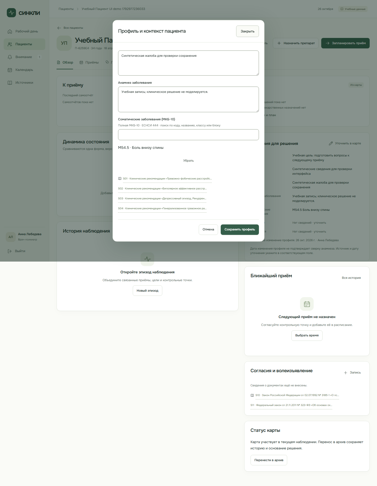

# Проверка полной МКБ-10

> **Статус документа:** Историческое свидетельство: результаты и ограничения относятся к указанной ниже дате и версии. Они не являются текущим статусом всего продукта. [Текущее состояние](../status.md).

26 октября 2026 года. Ветка `codex/doctor-major-update`, исходная версия `0ae22a1`. Windows, Node.js 24, .NET 10; только синтетические данные. [Источник и процедура импорта](../icd10-catalog.md).

## Результаты

- `node scripts/import-icd10.mjs --check`: версия, полнота и SHA-256 совпадают.
- `npm run check:web`: 207 тестов в 33 файлах; OpenAPI, TypeScript, подготовка форм и обе web-сборки проходят.
- `npm run check:fixtures`: 61 тест в 4 файлах; три набора данных соответствуют схеме.
- `npm run build:doctor:api`: 0 ошибок и предупреждений компилятора.
- `DOCTOR_UI_MODE=demo node scripts/verify-doctor-ui.mjs`: проходят все 10 этапов. Все запросы `**/api/**` прерываются тестом. M54.5 в профиле, U09.9 в эпизоде и U07.1 в приёме сохраняются и повторно открываются после перезагрузки.
- `node scripts/verify-doctor-api.mjs`: 41 проверка проходит на отдельном локальном API 127.0.0.1:5086 и новой синтетической PostgreSQL `doctor_icd10_1792977224097`. Все 14 641 актуальных кода прочитаны с пагинацией и сверены с локальным набором. Поисковые запросы по коду, названию, классам и блоку совпадают. Отдельный GET подтверждает сохранённые профиль, эпизод и диагнозы приёма из БД.
- Подмена названия, неизвестная версия, группировочный узел и неактуальный код отклоняются без изменения ревизии. Сохраняются ограничения клиники, связи с пациентом, CSRF и полномочия психиатра на подтверждение.
- Регрессии проверяют сохранение исторического кортежа без переписывания названия и запрет переноса учебной версии в новую запись. Старый текст эпизода сохраняется без угадывания кода.
- `npm run check`: форматирование проходит; остановка на 12 прежних битых ссылках в игнорируемых локальных `artifacts/patient-main-pr.md` и `artifacts/v04-build/site/README.md`.
- `npm run site:check` и `npm run build` отдельно: синтаксис лендинга и объединённая сборка проходят. `git diff --check`: без ошибок пробелов.

API запускался временным локальным harness из `.cache/`, создающим отдельную БД и передающим подключение дочерним процессам без вывода паролей. После теста API остановлен; существующая синтетическая БД не сбрасывалась. Для воспроизведения нужно поднять API на отдельной пустой локальной PostgreSQL, передать то же `ConnectionStrings__Doctor` процессу проверки и задать `DOCTOR_API_TEST_URL`. [Настройка сервера](../doctor-workspace-runbook.md).

## Границы

Технический разбор отдельным ИИ-агентом не выявил P1/P2; это не независимое одобрение участником команды или клиническое утверждение. Будущий сервер пациента не подключался. Локальный режим не требует клинического API; первоначальная загрузка приложения требует web-хоста.

Vite предупреждает о размере модулей: кабинет врача со справочником — около 4,78 МБ минифицированного JS / 504 КБ gzip. Порог предупреждения не повышался. Перед внешним развёртыванием полезно выделить справочник в отдельно загружаемый и кешируемый ресурс, сохранив локальный поиск. Рабочие запросы врача не обращаются к ЕСНСИ.
