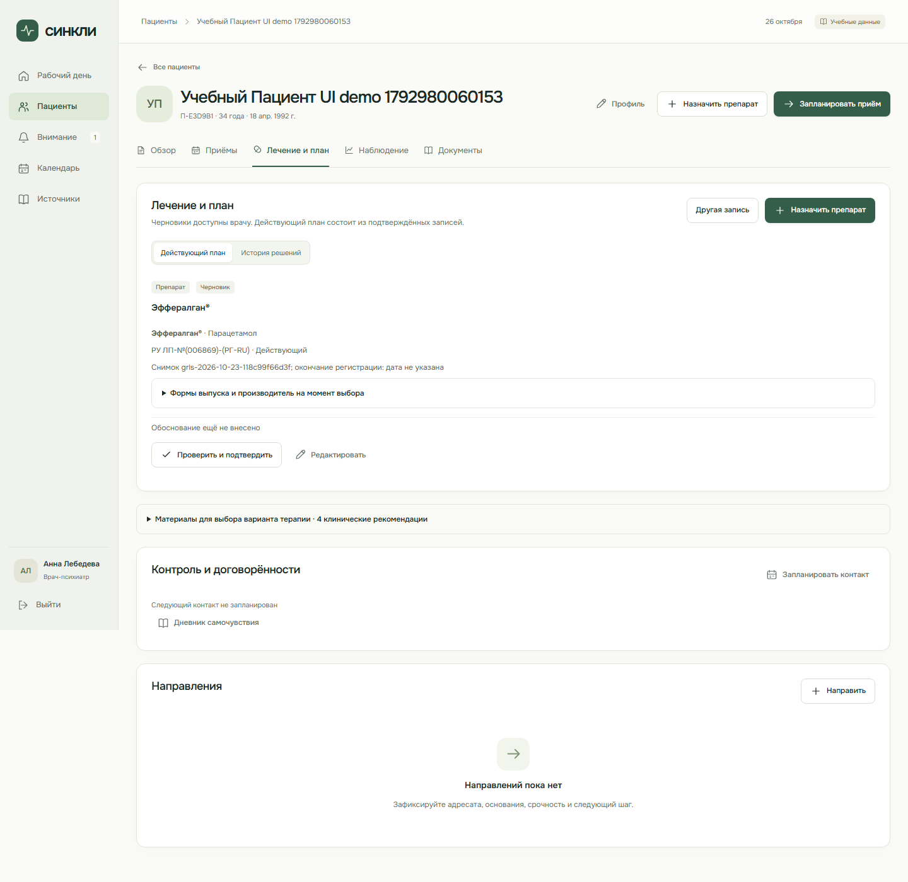

# Проверка актуального ГРЛС

> **Статус документа:** Историческое свидетельство: результаты и ограничения относятся к указанной ниже дате и версии. Они не являются текущим статусом всего продукта. [Текущее состояние](../status.md).

26 октября 2026 года, `codex/doctor-major-update`; Windows, Node.js 24, .NET 10. Только синтетические пациенты. [Источник, отбор, API и совместимость](../grls-catalog.md).

## Результат

Полный пользовательский ZIP от 23 октября обработан: восемь XLSX, 143 504 строки. В статический каталог включена 24 331 уникальная актуальная регистрационная запись на дату снимка. На 26 октября после текущей проверки сроков поиск возвращает 24 316 записей. Исторические, исключённые, истёкшие и приостановленные регистрации в новый выбор не предлагаются; фармацевтические субстанции исключены по явным признакам источника. Отдельный статус действующей регистрации на подтверждении не приравнивается к истёкшему.

[Независимое чтение исходного архива](assets/grls/source-check.json) через Python/openpyxl подтвердило числа строк каждого файла и все SHA-256 строк, включённых импортёром Node/ExcelJS: совпадение полное. Это проверка преобразования предоставленного архива, а не подтверждение актуальности портала сегодня.

## Проверки

| Команда / сценарий                                                    | Фактический результат                                                                                                                                                             |
| --------------------------------------------------------------------- | --------------------------------------------------------------------------------------------------------------------------------------------------------------------------------- |
| `node scripts/import-grls.mjs --check`                                | 24 331 запись; полнота, версия и SHA-256 совпадают                                                                                                                                |
| `npm run check:web`                                                   | 217 тестов в 37 файлах, OpenAPI, формы, TypeScript и обе web-сборки проходят                                                                                                      |
| `npm run check:fixtures`                                              | 61 тест в 4 файлах и проверка трёх наборов данных проходят                                                                                                                        |
| `npm run build:doctor:api`                                            | 0 ошибок и предупреждений компилятора                                                                                                                                             |
| `DOCTOR_UI_MODE=demo node scripts/verify-doctor-ui.mjs`               | Все 11 этапов проходят, включая пагинацию ГРЛС, выбор и сохранение регистрационного снимка после перезагрузки                                                                     |
| `node scripts/verify-doctor-api.mjs`, отдельный локальный API на 5086 | 43 проверки проходят в новой синтетической PostgreSQL `doctor_icd10_1792980238512`                                                                                                |
| `npm run check`                                                       | Форматирование проходит; общий процесс останавливается на 12 прежних битых ссылках в локальных игнорируемых `artifacts/patient-main-pr.md` и `artifacts/v04-build/site/README.md` |
| `npm run site:check`, `npm run build` отдельно                        | Синтаксис лендинга и объединённая сборка проходят; ресурс ГРЛС включён в общий `dist/assets/`                                                                                     |
| `git diff --check`                                                    | Ошибок пробелов нет                                                                                                                                                               |

Для API использовался временный локальный harness из `.cache/`: новая БД, отдельный порт, дочерние процессы с подключением без вывода паролей; сервер остановлен после проверки. Существующая БД не сбрасывалась. Для воспроизведения нужен API на отдельной пустой локальной PostgreSQL; задать то же `ConnectionStrings__Doctor` для запуска и проверки, а также `DOCTOR_API_TEST_URL`. [Настройка](../doctor-workspace-runbook.md).

## Что подтверждено

- Локальная и серверная выдача совпадают для МНН, торгового названия, формы, производителя и РУ, включая общий итог, версию и выбранные записи. Endpoint требует врачебную сессию и проверяет параметры пагинации.
- Браузерный demo-сценарий прерывал все запросы `**/api/**`. Полный ресурс ГРЛС загружался как статический файл. После перехода на вторую страницу выбран препарат, сохранён в IndexedDB и повторно показан с РУ/статусом после перезагрузки.
- Отдельное чтение через API подтвердило регистрационный снимок в PostgreSQL. Подмена статуса, названия и версии отклоняется без изменения ревизии. Подтверждённое назначение нельзя переписать; замена создаёт новую запись и сохраняет исходный препарат, регистрационные сведения и причину изменения.
- Старые текстовые назначения не угадываются по названию; остаются доступными без сброса истории. Локальная регрессия подтверждает переход от старой текстовой записи к новой версии из ГРЛС.
- При конфликте одинаковых торговых названий показаны различия РУ, формы, производителя, держателя, статуса и версии. Добавлен тест сравнения.
- Регрессия декодера проверяет и gzip-файл, и уже распакованный web-хостом HTTP-ответ; неверный SHA-256 отклоняется.
- Немедикаментозные подтверждения не требуют загрузки справочника. Полномочия, изоляция клиник/связь с пациентом, авторство и отдельное врачебное подтверждение сохраняются.

## Границы

Обработан предоставленный снимок, автоматического обновления ГРЛС нет. Инструкции не импортировались; существующие ссылка и правила её проверки сохранены. Доза и режим не подбираются автоматически. Настоящий сервер интеграции пациента не подключался, внешнего развёртывания не было. Технический AI-review нашёл два P2, оба исправлены и повторно проверены; это не независимое одобрение участником команды или клиническое утверждение.

ГРЛС вынесен из JavaScript в отдельный gzip-ресурс около 7,78 МБ, в памяти его JSON около 78,53 МБ плюс поисковый индекс. Это разовая загрузка при необходимости. Предупреждение Vite о крупных JS-модулях врача/администратора остаётся; пороги проверок не повышались.
