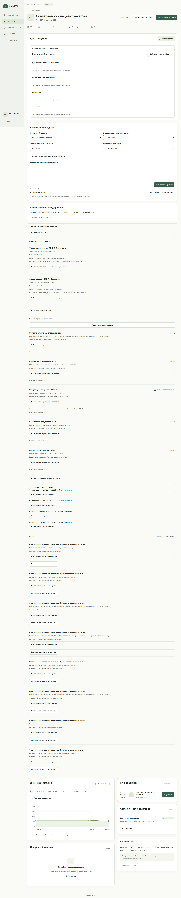
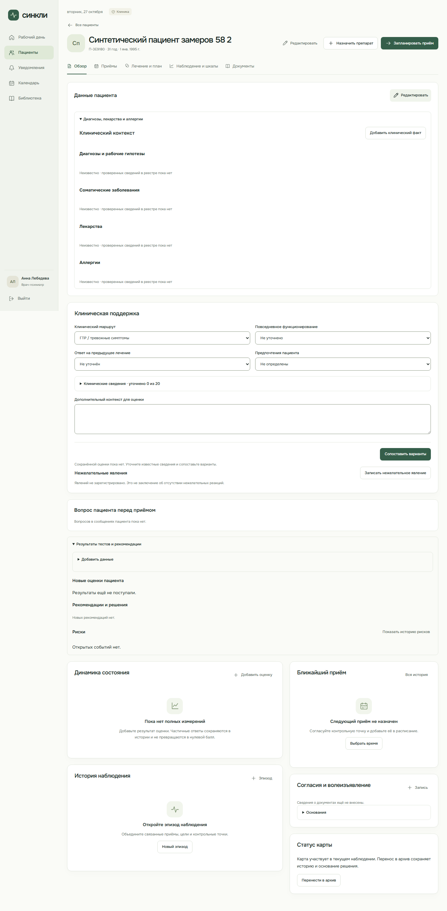

# Технические метрики: фактические измерения 27 октября 2026 года

> **Статус документа:** Историческое свидетельство: результаты и ограничения относятся к указанной ниже дате и версии. Они не являются текущим статусом всего продукта. [Текущее состояние](../../status.md).

Задача [#58](https://github.com/souponin-d/psycho/issues/58), владелец souponin-d.
Основание: [официальный кейс](../../official/2026-10-15-case.md),
[план](../../superpowers/plans/2026-10-27-technical-measurements.md).
T08 (кроссплатформенность) и T09 (масштабируемость) исключены пользователем.
По его последующему поручению T04 и техническая часть T05 выполнены автоматически,
без вымышленных участников или врачебных подписей.

Это протокол ограниченных инженерных испытаний. Числовые SLA не утверждены.
Наличие измерения не означает выполнение всего требования или клиническую приёмку.
Основное приложение и его исходная БД на VPS не останавливались и не заменялись.

## Стенды и метод

| Параметр      | Локальный стенд                            | Реальный VPS                                      |
| ------------- | ------------------------------------------ | ------------------------------------------------- |
| Исходники     | `ac1fd86e9aa3f89ee27f22f702448aa421e35cdb` | релиз `20261027-integration-90ee18d`              |
| CPU / память  | i7-12700H, 20 логических CPU, 16,89 GB RAM | 4 vCPU, 7185 MiB RAM, без swap                    |
| API / БД      | отдельные `127.0.0.1:5088` / `55458`       | ASP.NET Core 10.0.13 / PostgreSQL 17.11           |
| Развёртывание | Development, Debug, Vite на 8758           | Production, Caddy 2.11.7, Ubuntu/kernel 6.8.0-147 |
| Маршруты      | браузер → локальный API → новая БД         | прямой HTTPS VPS; браузер/HTTP через Layero → VPS |

Паспорта: [локальный](local-inventory.json), [VPS и 360 ресурсных наблюдений](vps-resources.ndjson).
На VPS в начале были три карты; при замере БД занимала около 11,4 MB.
Локальный отдельный врач получил три небольшие синтетические карты.
Данные, версии, конфигурации и транспорт различаются: сравнение не является
контролируемым тестом производительности двух одинаковых инсталляций.

HTTP-измеритель использует новое соединение на запрос, проверяет TLS, полностью
читает ответ и считает nearest-rank p50/p95/p99. Успешные задержки и все попытки
разделены; тайм-аут 20 s включён в ошибки и распределение всех попыток.
Браузер использует штатный Chromium 151, 1440×1000. Навигация после загрузки
работает с уже полученными картами; её нельзя сравнивать с полной HTTP-загрузкой.

## T01. Быстродействие

По 100 последовательных запросов, миллисекунды; p95 всех попыток:

| Операция                 | Локально | Прямой VPS | Через Layero |
| ------------------------ | -------: | ---------: | -----------: |
| Health с обращением к БД |   16,958 |    103,322 |     1107,243 |
| Получение списка карт    |   27,568 |    215,723 |     2397,698 |
| Поиск МКБ-10             |   32,525 |     97,611 |     1922,214 |
| Ошибки / попытки         |  0 / 300 |    0 / 300 |      4 / 300 |

Источники: [локальный baseline](local-three-cards.json), [прямой VPS](vps-direct.json),
[Layero](layero-http.json). У Layero один тайм-аут списка и три тайм-аута поиска.
Они сохранены, хотя p95 поиска ниже 20 s.

В диагностике последовательных запросов на самом VPS через тот же HTTPS Caddy
получено p95 15,581 / 44,339 / 23,836 ms, по 30 наблюдений без ошибок:
[исходные данные](vps-loopback.json). Это показывает вклад внешнего маршрута,
но не позволяет приписать все задержки только сети или только Layero.
Генератор этой диагностики делил ресурсы VPS; параллельной нагрузки в ней не было.

| Браузерная операция                  | Локально, p95 ms | Layero, p95 ms | Повторы на стенд |
| ------------------------------------ | ---------------: | -------------: | ---------------: |
| Показ списка после навигации         |           28,544 |         25,198 |               30 |
| Открытие карты из полученного списка |          127,821 |        115,405 |               30 |

[Локальный браузер](local-ui-ready.json), [публичный браузер](layero-ui-verified.json).
В каждом успешном прогоне нет pageerror. Первое открытие формы входа:
1,481 s локально и 2,738 s публично; вход до рабочего дня: 0,238 / 2,453 s.
Это одиночные наблюдения, а не устойчивые перцентили холодного старта.

Локальный движок поддержки: 100 вычислений, p95 1,084 ms;
[выборка](code-measurements.json). Это время функции на малой карте, без сети,
хранения и отображения. Доставку критического алерта до экрана врача/фона
в этом цикле отдельно не измеряли; время генерации вывода её не заменяет.

## T02. Обработка входных данных

[Корпус](extraction-corpus.json): 100 синтетических документов, пять шаблонов
по 20, семь ожидаемых разделов на документ. Единица оценки — точный раздел
и его значение, а не диагноз/лекарственная сущность после NLP.

| Шаблон                        | Точных совпадений / ожидаемых |     Precision | Recall |  F1 |
| ----------------------------- | ----------------------------: | ------------: | -----: | --: |
| Однострочные заголовки        |                     140 / 140 |             1 |      1 |   1 |
| Другой порядок, регистр, тире |                     140 / 140 |             1 |      1 |   1 |
| Значение на следующей строке  |                       0 / 140 | не определена |      0 |   0 |
| Нумерованные разделы          |                       0 / 140 | не определена |      0 |   0 |
| Свободное описание            |                       0 / 140 | не определена |      0 |   0 |

Итого recall 280/700 = 40%; точность выданных 280 разделов — 100% на этом корпусе.
Это обнаруженное ограничение текущего извлекателя; устойчивость к разным шаблонам
не подтверждена. Корпус создан автоматически, без клинической разметки;
OCR/PDF, отрицания на уровне медицинских сущностей и свободный анамнез не оценены.
Продуктовый извлекатель не изменён.

## T03. Надёжность и корректность

- Изолированная локальная API-проверка: 86 групп пройдены, включая роли,
  конфликты, идемпотентность, версии, исходные ответы, ограничения команд.
- Серверная клиническая политика: 19 проверок пройдены.
- [Реальный VPS](vps-security-verified.json): 6/6 отрицательных/инвариантных проверок;
  [повтор пяти записей](vps-command-verified.json) сохранил ровно по одному сообщению.
- [Изолированный аварийный прогон на VPS](vps-isolated-recovery.json): подтверждённая
  запись сохранена, повтор без дубля, неподтверждённая команда доставлена после запуска.
- `check:web`: 393 теста пройдены, один упал. Отдельный повтор подтвердил тот же сбой.
  Тест `clinical-support.test.ts:251` создаёт оценку на 26.10, но проверяет её
  актуальность без явного времени; ключ контекста включает текущую дату 27.10.
  Это воспроизводимая зависимость теста от календаря, а не доказательство поломки
  клинического сценария. Исправление в эту задачу не включено.
- Старый полный `verify-doctor-ui.mjs`: вход прошёл, затем ожидание отсутствующей
  кнопки «Профиль» завершилось тайм-аутом; весь сценарий **не прошёл**.

HTTP-ошибки под нагрузкой приведены в T06. Совокупность этих проверок не является
проверкой всех сочетаний входов или подтверждением медицинской корректности.

## T04. Эргономика: автоматическое прохождение задач

Фактические нажатия и заполнения через браузер; один click/fill считается действием.
Начальная карта/сессия подготовлены до таймера, чтение и размышление не моделируются.
По десять успешных повторов каждой указанной задачи:

| Задача                                                  | Действий | Локально p50 / p95 ms | Публичный контур p50 / p95 ms |
| ------------------------------------------------------- | -------: | --------------------: | ----------------------------: |
| Найти пациента и открыть карту                          |        3 |     173,285 / 206,776 |             170,983 / 208,432 |
| Открыть динамику из карты                               |        1 |       54,194 / 90,651 |               42,504 / 75,470 |
| Открыть сообщения из карты                              |        2 |     139,229 / 168,051 |             148,439 / 204,996 |
| Отправить синтетическое сообщение с HTTP-подтверждением |        2 |           не измерено |             318,162 / 944,544 |

Данные: [локальные задачи](local-tasks.json), [первые три публичные задачи](layero-tasks.json),
[подтверждённая отправка](layero-send-final.json). p95 при n=10 совпадает с максимумом.
Перед каждым повтором отправки заново загружается серверная карта; подготовка
не входит в длительность задания. Все десять сообщений явно синтетические.
Это стоимость известного пути в интерфейсе; обнаружимость, когнитивная нагрузка,
ошибки людей, доступность и время пациента в установленном APK здесь не измерены.

## T05. Автоматическая проверка оснований

[50 синтетических наборов входов](code-measurements.json): повторяемость результата,
инвариантность к порядку наблюдений, отсутствие мутации входов — 50/50 для каждого
условия. Все 742 полученных вывода/варианта имеют разрешимые source IDs с версией,
URL и локатором; 18/18 источников каталога имеют эти метаданные.

Это проверка прослеживаемости и воспроизводимости, выполненная автоматически
по поручению пользователя. Она не проверяет, что конкретный текст источника
действительно обосновывает каждый вывод, актуальность всех редакций и медицинскую
правильность. В каталоге форм 0 записей врачебного одобрения. Врачебное утверждение
не выдумано и не заменено повторным запуском той же функции.

## T06. Нагрузка

Прямой VPS: окно запуска запросов 60 s на ступень, затем ожидание завершения;
пауза потока 1 s. 80% запросов — полный список карт, 20% — поиск МКБ.
Тайм-аут запроса 20 s. Потоки используют **одну** аутентифицированную сессию:
это конкурирующие запросы к данным одного врача, не столько независимых пользователей.

| Потоки | Запросы | RPS с учётом завершения | Ошибки | p95 всех попыток, ms |
| -----: | ------: | ----------------------: | -----: | -------------------: |
|      1 |      51 |                    0,85 |      0 |              313,076 |
|      5 |     265 |                    4,41 |      0 |              217,151 |
|     10 |     515 |                    8,58 |      0 |              388,147 |
|     25 |    1299 |                   21,65 |      0 |              303,518 |
|     50 |    2276 |                   37,49 |      0 |             1142,500 |
|    100 |    2391 |                   33,99 |     33 |             7224,622 |

На 100 потоках 1,38% транспортных ошибок; пропускная способность снизилась.
Уровень 100 не засчитывается как подтверждённая ёмкость клиники.
На VPS во всём ресурсном окне CPU максимум 35,22%, RSS API максимум 629852 KiB,
доступная память минимум 6134464 KiB, максимум 65 соединений БД.
Это не доказывает отсутствие серверных узких мест: нужен разбор TLS/сети/прокси.
Три коротких восстановления БД пересекались со ступенью нагрузки;
их возможный вклад отдельно не вычитался.

Через Layero на 25 потоках: 563 запроса, 4 ошибки, p95 3361,913 ms.
[Исходные данные](layero-http.json). Часть этапа подготовки временных SQL-таблиц
пересекалась с публичными измерениями; это не полностью изолированный эксперимент.
Локальный [повтор на стабильной БД](local-http-verified.json): до 100 потоков,
3000 запросов за последнюю 30-секундную ступень, 0 ошибок, p95 35,859 ms.
У этого локального врача в момент нагрузочного повтора не было карт;
для трёх карт отдельно выполнен baseline. Такой нагрузочный результат не сравним
по объёму ответа с публичным врачом и не используется как оценка серверной ёмкости.

Это короткие диагностические ступени. Не выполнены первоначально предложенные
10-минутные ступени, двухчасовой soak, смешанная нагрузка записи и множество
независимых сессий. После обнаружения сетевых тайм-аутов длительное увеличение
нагрузки не заменяет диагностику. SLA/максимум пользователей не объявляются.

## T07. Отказ и восстановление

[Три восстановления на VPS](vps-restore.json): экспортированный PostgreSQL snapshot
удерживался read-only-транзакцией во время `pg_dump`; количества и хеши всех восьми
таблиц восстановленной БД совпали с тем же снимком, включая аудит при параллельных чтениях.

| Повтор | Dump, s | Создание/restore БД, s | Restore и сверка, s |
| ------ | ------: | ---------------------: | ------------------: |
| 1      |   0,272 |                  1,615 |               1,819 |
| 2      |   0,267 |                  0,736 |               0,919 |
| 3      |   0,334 |                  0,800 |               0,986 |

[Отдельный аварийный экземпляр](vps-isolated-recovery.json) восстановил БД,
копии API, Data Protection keys и сертификата. Создана синтетическая запись;
SIGKILL получил только созданный процесс на порту 5098, затем запущена та же копия.

- От сбоя до health: **5,245 s**; до чтения и проверки повторной команды: **5,398 s**.
- Сессия, выданная до сбоя, сохранилась; подтверждённая запись 1/1, потеря 0, дублей 0.
- Запрос во время сбоя не получил ложного подтверждения; удержанная измерителем
  команда после перезапуска доставлена ровно один раз.
- Новая БД должна иметь исходного владельца: первая попытка запуска копии выявила
  `42501 permission denied for schema public`. В измерителе исправлено создание
  только новой БД с её исходным владельцем; права рабочей БД не менялись.

Эти числа описывают процессный сбой на том же VPS. Они не являются RTO/RPO
потери всего сервера или диска. Долговечная очередь APK, внешняя резервная площадка,
автоматическое расписание копирования и восстановление сети не проверены.
При переносе на чистый сервер также нужны роли БД и весь комплект конфигурации.

## T10. Гибкость архитектуры

Фактически выполнены четыре эксперимента **в памяти отдельного процесса**:
регистрация новой версии формы, добавление класса условного препарата,
добавление предупреждения взаимодействия, добавление пункта существующего каталога.
Все новые записи обнаружены соответствующими функциями, старые версии формы
сохранились; после удаления добавлений каталог побайтно равен исходному JSON.
[Протокол](code-measurements.json), `extension`.

Ядро и файлы продукта не менялись. Это доказывает расширение существующих схем
каталогов, но не произвольного расчёта новой шкалы, регистрации лекарства,
произвольных условий алертинга, нового модуля, миграции или безопасной активации.

## T11. Данные и скорость доступа

На реальном PostgreSQL созданы временные таблицы формы текущих `patient_records`
и `care_relationships`, с копиями явно синтетической JSONB-карты и индексами.
Все изменения откатились; исходные записи не менялись. По одному прогону на размер:

| Карт | Объём JSON-текста | SQL списка, ms | Поиск по имени в JSONB, ms |
| ---: | ----------------: | -------------: | -------------------------: |
|  100 |          25,32 MB |          0,181 |                     48,916 |
| 1000 |         253,21 MB |          1,248 |                    530,408 |

[EXPLAIN ANALYZE и планы](vps-data-growth.json). Время SQL списка не включает
сериализацию, передачу и отрисовку сотен мегабайт. Поиск/период — исследовательские
SQL-запросы; не утверждается, что UI выполняет их на сервере.
Попытки набора 10000 прерваны `statement_timeout=60s` во время общего SQL-эксперимента;
фаза отдельно не инструментирована, поэтому задержка поискового запроса на этом размере
не установлена. Увеличение тайм-аута на рабочем VPS не выполнялось.

Текущий `Store.List` возвращает все полные карты врача. Полученные числа SQL
не подтверждают готовность такого API к большой клинике. Расширение модели
с реальной версионированной миграцией в этом цикле не выполнялось.

## T12. Полнота модели

[Структурная сверка](code-measurements.json), `model_coverage`: 16 групп полей карты,
шесть текущих синтетических примеров. В модели представлены профиль, эпизоды,
приёмы, оценки, назначения, отчёты, события, согласия, сообщения, направления,
документы, аудит, факты, поддержка, приверженность и workflow.
Непустые примеры найдены для 12/16 групп; сообщения, направления, документы и
приверженность в стандартном seed не заполнены. Это пробел примеров, не отсутствие
соответствующей структуры. Сообщения отдельно проверены на публичном API.

Роли, клиника и связь врача с пациентом представлены отдельными таблицами;
история версий, квитанции и серверный аудит входят в проверенные восемь таблиц.
Полноту обязательных клинических атрибутов и всех F/M требований нельзя выразить
долей присутствующих контейнеров; процент клинического покрытия не объявлен.

## T13. Защищённость

[Шесть публичных проверок](vps-security-verified.json) прошли: аноним не читает карты,
пациент не получает врачебный API, мутация без CSRF отклонена, HTTPS cookies Secure,
неизвестная пациентская команда получает 403, релиз неизменен.
Локальные API/политики дополнительно проверяют изоляцию и отзыв прав.
На VPS API/БД/Caddy admin слушают loopback; env/PFX имеют 0640 root:syncli,
ключи — 0700 syncli:syncli. TLS не отключался.

[`npm audit`](dependency-audit.json): 9 записей пакетов, 4 high и 5 moderate,
0 critical. High включают `@expo/cli`, `expo`, `node-forge`, `zod`; часть записей
наследуется по цепочкам и не является отдельной независимой уязвимостью.
Эксплуатируемость в поставке не исследована; зависимости автоматически не обновлялись.
Полный pentest, защита мобильного хранилища и правовое соответствие не подтверждены.

## Валидность и повторение

Сохранены и неуспешные первоначальные прогоны. Их исключения из выводов обоснованы:

- В `vps-direct.json` базовые чтения и нагрузка валидны; первая серия записи
  отклонена из-за не обновлённого после входа CSRF измерителя. Исправленный
  результат записи — `vps-command-verified.json`, финальные отказы — `vps-security-verified.json`.
- В `vps-command-verified.json` запись верна, но ожидался ошибочный 400 вместо 403
  для неизвестной команды; окончательная проверка 403 отдельно пройдена.
- В `layero-http.json` ранние пациентские проверки также имели старый CSRF;
  их нельзя использовать как доказательство проверки бизнес-валидации. Чтение/нагрузка валидны.
- `local-http.json` пересекался с интеграционным заполнением другой тестовой клиники;
  повтор `local-http-verified.json` был после него. Наполнение врача было нулевым;
  сопоставимый по числу карт baseline — `local-three-cards.json`.
- Ранние UI-файлы без `ready`/`verified` содержат неверное ожидание кнопки или
  отсутствие подготовленной карты. Первые send-task прогоны имели неверный locator,
  затем преждевременное окончание по видимому тексту и повтор в не сброшенном состоянии.
  Итоговая отправка ждёт HTTP и начинается с заново загруженной карты.

Для воспроизведения измерителя:

```sh
python scripts/test_technical_measurements.py
python scripts/measure-technical-http.py --origin https://176.32.37.10 --config PRIVATE_JSON --output RESULT_JSON --iterations 100
node --import ./scripts/technical-measurements/resolve-ts.mjs scripts/technical-measurements/measure-code.mjs
node scripts/technical-measurements/measure-ui.mjs https://syncli-main.layero.app/doctor/ PRIVATE_JSON OUTPUT_PREFIX
node scripts/technical-measurements/measure-tasks.mjs https://syncli-main.layero.app/doctor/ PRIVATE_JSON RESULT_JSON
```

Приватный JSON содержит существующие `doctorEmail`, `doctorPassword`; для
пациентских проверок — `accessCode`, для задач — `patientId` явно синтетической карты.
Он не входит в Git. CLI `--write-synthetic` нужен только для пяти пациентских
сообщений; task-измеритель отправляет десять сообщений в явную синтетическую карту.
Нагрузочные ступени: `--levels 1,5,10,25,50,100 --stage-seconds 60`, пауза 1 s.
Для этого Windows-маршрута применялся `--wifi-source 192.168.1.15 --wifi-interface 13`;
эти значения зависят от рабочего места и не требуются в обычной сети.

`server-probe.py`, `restore-probe.py`, `data-probe.py`, `recovery-probe.py`
передаются через проверенный SSH в `python3 -`. Они предназначены для описанного
синтетического VPS; recovery использует отдельный порт 5098 и временную БД.
Нельзя применять их к настоящим пациентским данным как универсальные инструменты.

Автоматический review запретил диагностическую параллельную нагрузку из самого VPS.
Она не выполнялась; безопасная замена — 90 последовательных HTTPS-запросов без ступеней.

## Проверки ветки

- Python-измеритель: 5/5 тестов, включая CSRF и отсутствие секретов в ошибках.
- API: 86/86 групп; политика: 19/19; fixtures: 61/61.
- `check:web`: 393/394; единственный сбой отдельно воспроизведён, описание выше.
- Полный старый UI-сценарий: 0/1, устаревший locator, описание выше.
- `npm run check`: форматирование, Markdown-ссылки, синтаксис и полный build прошли.
- JSON-артефакты и Python-синтаксис проверены; совпадений с известными секретами нет.
- Временные dump-файлы удалены; исправление очистки проверено ещё тремя восстановлениями: [протокол](vps-restore-cleanup-check.json), [очистка прежних файлов](vps-cleanup.json).
- ИИ-ревью измерителей выявило два P2 (код возврата неуспешной задачи и очистка dump); оба исправлены и повторно проверены. Это не независимый contributor approve.




